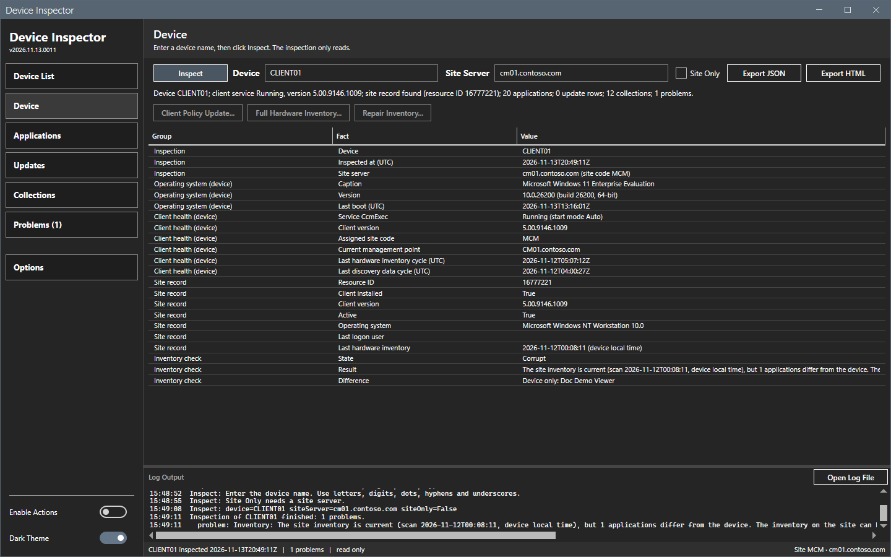
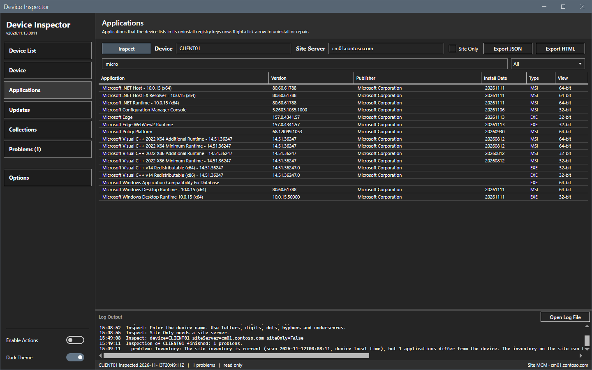
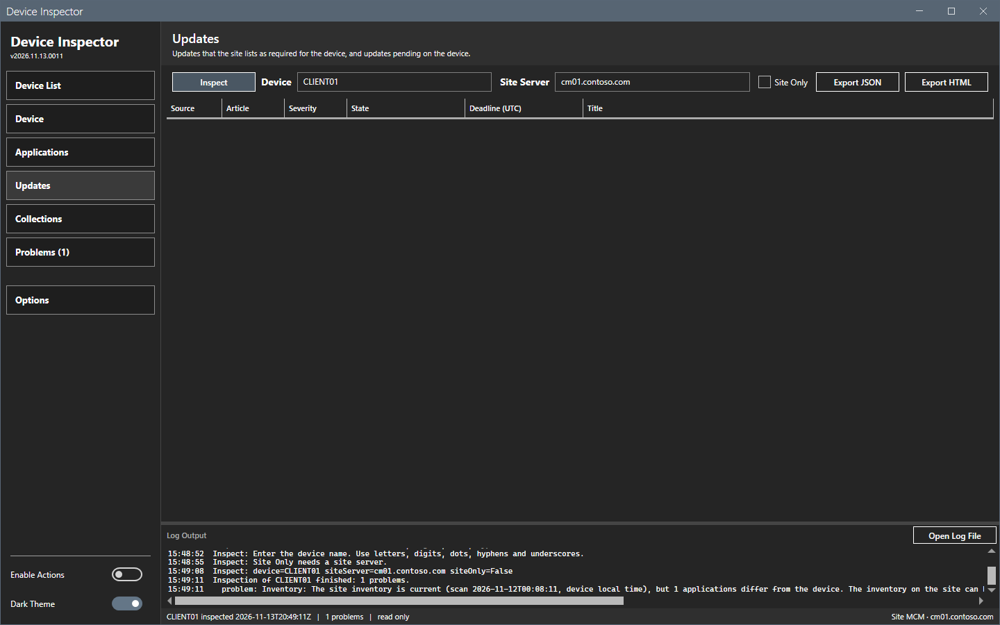
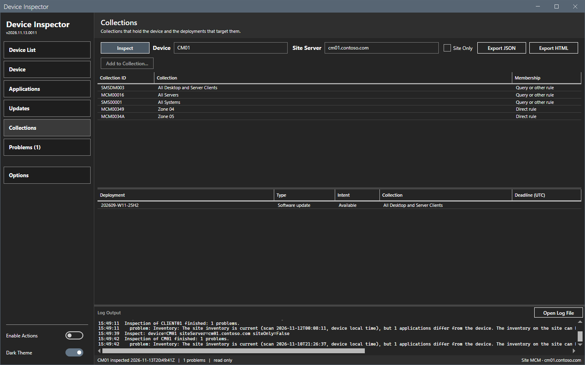
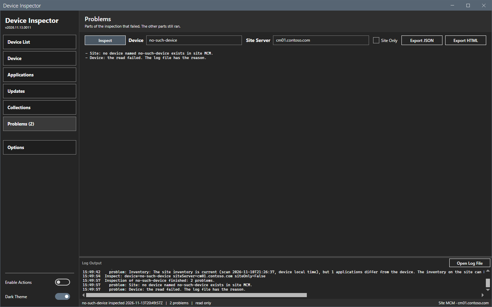

# Device Inspector

[](https://github.com/jasonulbright/device-inspector/releases/latest)
[](https://github.com/jasonulbright/device-inspector/releases)
[](#requirements)
[](LICENSE)

Read the facts of one device from a Configuration Manager site and from the device itself, in one window: operating system, client health, site record, installed applications, updates, collections and deployments. Export the result as JSON or as an HTML report. The inspection is read only. Actions, such as a client policy update, run only when **Enable Actions** is on, after a confirmation with a dry run, and each one goes to an action log.



## User guide

The user guide is in [docs/index.md](docs/index.md). It has one page for each part of the window, a settings page, the command line, reference pages and troubleshooting. Every image in it is a capture of the running window.

## Features

- One window, six panels: Device List, Device, Applications, Updates, Collections, Problems.
- Shows the applications that the device lists in its uninstall registry keys now (64-bit and 32-bit). Each row has a type, MSI or EXE. A right-click uninstalls or repairs an entry from its key, behind Enable Actions.
- Lists the updates that the site requires for the device and the updates pending in the client policy on the device.
- Lists the collections of the device and the deployments that target them.
- Keeps going when one part fails. A part that fails (a device that is off, a device the site does not know) is listed under Problems. The other parts still run.
- Exports the inspection as JSON or as a self-contained HTML report.
- Read only. The tool reads the site with ConfigurationManager cmdlets (and `SELECT` queries through `Invoke-CMWmiQuery` where no cmdlet exists) and reads the device with one remote script block. The inspection never changes the site or the device. A test checks the inspection code and the window script for state-changing commands.
- Actions behind a switch. **Enable Actions** is off at each start. Each action asks for a confirmation that shows the device count, offers a dry run, and writes to `Logs\DeviceInspector-actions.log` with an action ID. An action on a device runs in the background, so you can work on other devices; a device runs one action at a time. See [docs/core/actions.md](docs/core/actions.md).
- Dark and light themes with a runtime toggle, like the other tools of the AppPackager Suite.

## Requirements

- Windows 10 / 11 or Server 2016+
- PowerShell 5.1 (PowerShell 7 also works)
- .NET Framework 4.7.2+
- The Configuration Manager console on the computer that runs the tool. The tool reads the site with the ConfigurationManager PowerShell module, which comes only with the console. Without the console the tool shows a message and stops.
- Network access to the site server (SMS Provider computer).
- WinRM access to the device. The account needs local administrator rights on the device, because the tool reads the device remotely.
- For the site: a domain admin account that is also a local administrator of the SMS Provider computer. It needs no Configuration Manager security role (a new site has no roles). An account with fewer rights on the site is not tested. Do not rely on one.

The window connects with the Windows account that runs it. It stores no password and has no credential field. The command-line script accepts `-Credential`.

## Quick Start

1. Download the release zip and extract it to a working folder.
2. Right-click `start-deviceinspector.ps1` -> **Run with PowerShell**, or from a PowerShell prompt:

   ```powershell
   powershell -ExecutionPolicy Bypass -File start-deviceinspector.ps1
   ```
3. Enter the device name. The site server box shows the saved site server and is read-only. **Options** is the only place that sets the site server (the SMS Provider FQDN) and the site code. The site code is required when a site server is set. The footer shows both at the right end, for example `Site XYZ · sms01.example.com`. Select the footer text to open **Options**.
4. Click **Inspect**.

Clear the site server in **Options** to read only the device. Select **Site Only** to read only the site. Inside the AppPackager Suite, the launcher hands its site code and provider to the tool.

## Panels

- **Device** -- a summary line, then the facts: operating system, client health (service state, client version, assigned site code, management point, last hardware inventory and discovery cycles) and the site record (resource ID, client installed, client version, active, operating system, last logon user, last hardware inventory time).
- **Applications** -- the device list and the site inventory list, merged by name. A filter box and a status filter narrow the rows.
- **Updates** -- updates that the site lists as required for the device (expired updates are left out; superseded updates are marked) and updates pending on the device with their evaluation state and deadline.
- **Collections** -- the collection memberships, and the deployments that target those collections.
- **Problems** -- the parts that failed.









The right-click menus of the Applications, Updates and Collections grids are in place for later actions. They are disabled. See [docs/core/actions.md](docs/core/actions.md).

## Command line

The window wraps the same module as the script `Invoke-DeviceInspector.ps1`. The script prints the text report and writes JSON with `-JsonPath`:

```powershell
.\Invoke-DeviceInspector.ps1 -ComputerName WS01 -SiteServer sms01.example.com -SiteCode XYZ -JsonPath .\ws01.json
```

| Parameter | Meaning |
|---|---|
| `-ComputerName` | The device. Required. |
| `-SiteServer` | The site server. Omit it to skip the site facts. |
| `-SiteCode` | The site code. Required with `-SiteServer`. |
| `-Credential` | Optional credential for both connections. |
| `-SkipDevice` | Do not contact the device. |
| `-JsonPath` | Write the facts as JSON (UTF-8 without BOM, dates in ISO 8601 UTC; a deployment deadline has no zone, because the site stores local time). |
| `-MaximumListedItems` | The most entries in each report list. Default 25. The JSON has all entries. |

## Files written on disk

| File | Purpose |
|------|---------|
| `DeviceInspector.prefs.json` | Theme, site code, site server, the last device name, Site Only |
| `DeviceInspector.windowstate.json` | Window size, position and last-used panel |
| `Logs\DeviceInspector-*.log` | Per-session tool log |
| `Logs\DeviceInspector-startup-*.txt`, `Logs\DeviceInspector-crash-*.txt` | Start transcript; details of an unhandled error |
| `Reports\*` | Exports |

## Tests

```powershell
.\Invoke-Checks.ps1
```

The button guard test skips the message boxes of the suite module until the suite repository changes their buttons. Their disabled text keeps the suite colors.

The script runs PSScriptAnalyzer with the shared settings, then the Pester tests. The tests need no lab. CI runs the tests under Windows PowerShell 5.1 and PowerShell 7. The window tests (Tests/Window.Tests.ps1) open windows off screen and run only when SUITE_ALLOW_WINDOW_TESTS is 1. CI sets it.

## Project Structure

```
device-inspector/
+- start-deviceinspector.ps1         # WPF shell
+- MainWindow.xaml                   # Main window layout
+- Invoke-DeviceInspector.ps1        # Command line entry point
+- Invoke-Checks.ps1                 # Linter and tests
+- Lib/                              # Vendored MahApps.Metro 2.4.10
|  \- SuiteCommon/                   # Vendored shared core: logging, settings, theme, dialogs
+- Module/
|  +- DeviceInspectorCommon.psd1     # Module manifest
|  \- DeviceInspectorCommon.psm1     # Inspection logic and window support
+- Tests/                            # Pester 5 tests
+- tools/guide-capture/              # Capture scripts for the guide images (see docs/index.md)
+- docs/reference/read-only-design.md          # Scope, read-only design, limits
```

## License

MIT. See [LICENSE](LICENSE). Third-party notices: [THIRD-PARTY-NOTICES.md](THIRD-PARTY-NOTICES.md).
