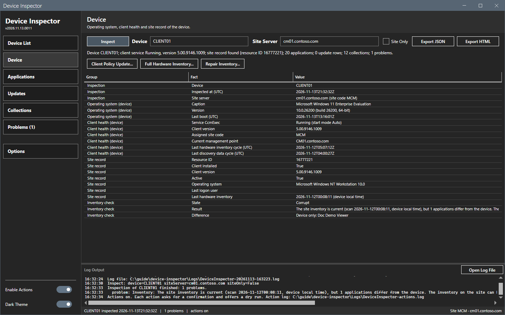
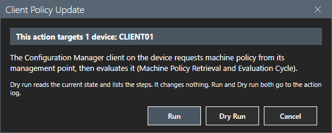
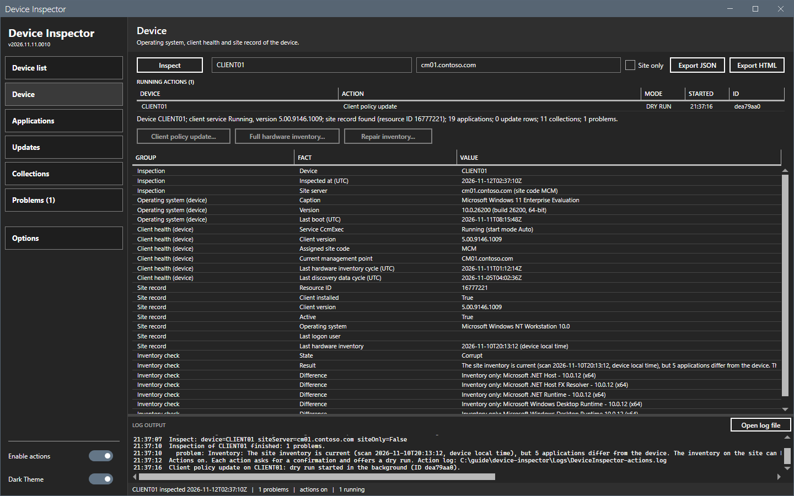
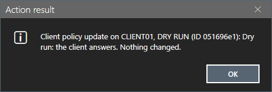
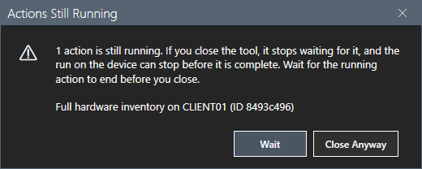
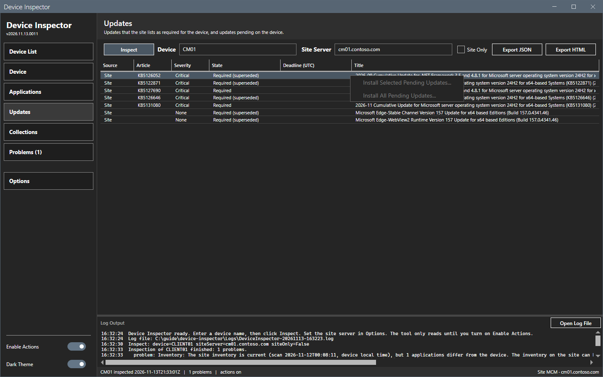
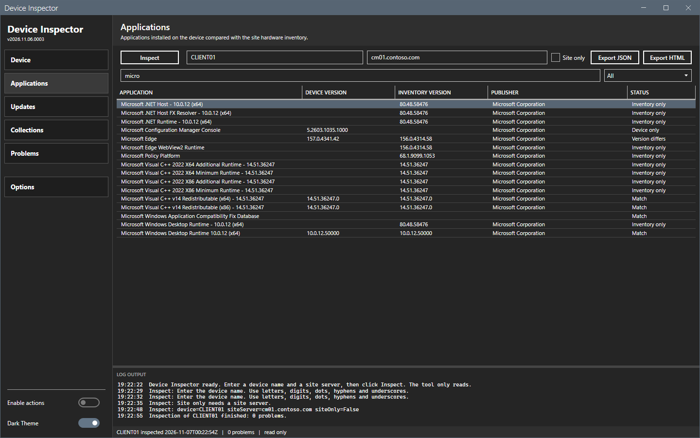
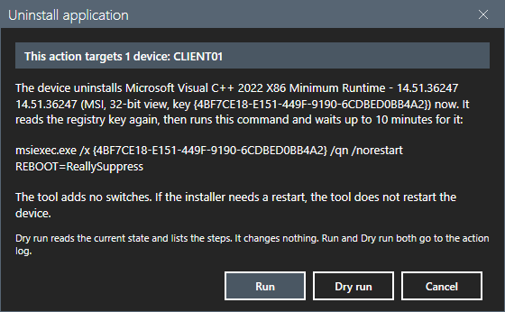
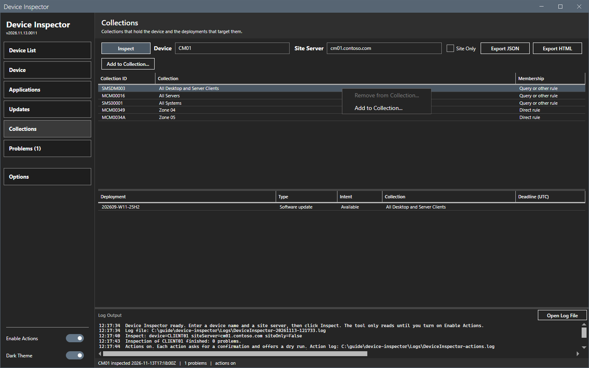
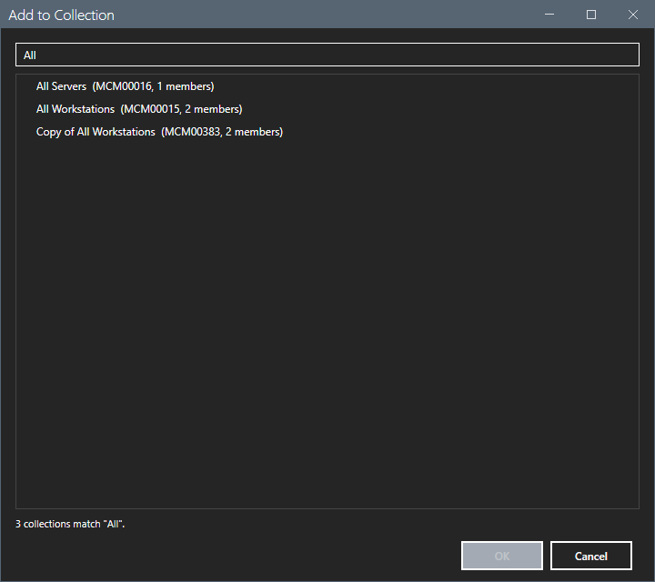

# Actions

The actions change the device or the site. They are off until you turn on **Enable actions**.

## What it does

Each action follows the same steps:

1. You turn on **Enable actions** at the bottom of the sidebar. The switch is off at each start of the tool. The status bar shows "actions on" while it is on.
2. You select the action button.
3. A dialog names the action. A banner at the top shows the number of devices that the action targets, and their names.
4. You select **Run**, **Dry run** or **Cancel**. **Cancel** is the default button, so Enter and Esc change nothing.
5. The action gets an action ID: eight characters, for example `a1b2c3d4`. A dry run gets an ID too.
6. The action runs in the background. **Dry run** reads the current state and lists the steps, and changes nothing.
7. Before a run, the tool writes a `STARTED` line with the ID to the action log. If it cannot write the line, the run does not start. When the run ends, the result line with the same ID goes to the action log, and the result goes to the window log and to the tool log. A result window shows the result. See [Running actions](#running-actions).





## Running actions

An action on a device runs in its own background task. The window stays free while it runs:

- You can inspect other devices and search the device list.
- You can start actions on other devices. Each device has its own task.
- A list **RUNNING ACTIONS** appears under the Inspect bar while at least one action runs. Each row shows the device, the action, the mode, the start time and the ID. A row goes away when its run ends. The status bar shows how many actions run.



A device runs one action at a time. A run, and a dry run, counts as an action. The tool compares devices by a key: the name in lower case, without the text after the first dot. `WS01`, `ws01` and `WS01.CORP.LOCAL` are one device. An IP address stays as it is, so an IP address and a name are two devices, unless the inspection knows the site resource ID of the device. Two runs with the same resource ID are on the same device. When the device of the inspection on screen has a running action:

- the action buttons are off, and their tooltip names the running action, its ID and its start time;
- the right-click menu entries of the actions are off, with the same reason as the tooltip;
- an action that you start in another way is refused with the same reason.

You can start the next action on the device after the first one ends.

When a run ends, a result window opens. It does not take the focus, so your typing and clicks stay in the main window. Select **OK** to close it. The tool refreshes the view of the result only when the inspection on screen is of the same device. After a **Full hardware inventory**, for example, the inventory check changes only for the device on screen. When the device is not on screen, the window log says to inspect it again.



The inspection, the device list search and the changes of the site (**Add to collection...** and **Remove from collection...**) keep their own way: they hold the window until they end, and the progress panel shows them. A change of the site runs on the computer of the tool, in the Configuration Manager console module, so it cannot go on without the window. The tool refuses a change of the site while the device has a running action. These changes have an ID in the action log too.

### Close the window while actions run

When you close the window while actions run on devices, the tool shows a warning. It says: "N actions are still running. If you close the tool, it stops waiting for them, and a run on a device can stop before it is complete. Wait for the running actions to end before you close." The text names each running action and its ID. The default button is **Wait**, so Enter and Esc do not close the tool. Select **Close anyway** to close.



- Before it closes, the tool reads the runs that ended since its last check. Those runs get their real result line.
- The tool does not stop the other runs. It stops waiting for them. It cannot write their result lines. A run on a device can stop before it is complete, so the result is not known.
- The tool writes one line with the outcome `CLOSED` and the ID of the run for each action that was still open. A real run has the `STARTED` line with the same ID.

Inspect the device later to see its state.

## When to use it

- Use **Dry run** first, to see the steps and to check that the device answers.
- Use **Run** to make the change.

## Requirements

- An inspection that reached the device. With **Site only**, the device actions stay off.
- The rights in [Permissions](../reference/permissions.md). The tool uses the Windows account that runs it. It stores no password.

## Steps

### Update the client policy

The **Client policy update...** button is on the Device panel.

1. Turn on **Enable actions**.
2. Inspect the device.
3. On the Device panel, select **Client policy update...**.
4. Select **Dry run**. The log shows the client version and the two steps.
5. Select **Client policy update...** again, then **Run**.

The client requests machine policy from its management point (schedule `{00000000-0000-0000-0000-000000000021}`, Machine Policy Assignments Request) and then evaluates it (schedule `{00000000-0000-0000-0000-000000000022}`, Machine Policy Evaluation). This is the Machine Policy Retrieval and Evaluation Cycle of the client. The request returns at once. The client downloads and applies the policy in the next minutes.

### Start a full hardware inventory

The **Full hardware inventory...** button is on the Device panel. Use it when the site shows old or wrong hardware inventory for the device.

1. Turn on **Enable actions**.
2. Inspect the device.
3. On the Device panel, select **Full hardware inventory...**.
4. Select **Dry run**. The log shows the status record of hardware inventory on the device (last cycle, last report, report version) and the steps.
5. Select **Full hardware inventory...** again, then **Run**.

The tool deletes the `InventoryActionStatus` record of hardware inventory (`{00000000-0000-0000-0000-000000000001}`) in `root\ccm\invagt` on the device. Then it triggers the Hardware Inventory schedule. Without the record, the client sends a full report instead of a delta report, and the site replaces all hardware inventory of the device. When no record exists, the tool only triggers the schedule. When the delete fails, the tool does not trigger the schedule. The client log `InventoryAgent.log` shows the full report. The site shows the new inventory date after it processes the report. When hardware inventory is off in the client settings, the client sends no report.

### Install pending updates

The Updates panel has two entries in its right-click menu:

- **Install selected pending updates...** installs the selected rows.
- **Install all pending updates...** installs all rows that can be installed.



A row can be installed when its source is `Device`, the client lists the update as missing on the device (`ComplianceState` 0), and no install job is in progress or complete for it (state None, Available or Error). A row with the source `Site` is the view of the site and cannot be installed from here. An entry that is off shows the reason as its tooltip. A right-click selects the row under the pointer when that row is not selected.

Both entries send the IDs of the rows in the confirmation, so an update that arrives after the inspection is not installed without a confirmation. The device skips an update that has an install job in progress or complete (state other than None, Available or Error) and says so in the log.

1. Turn on **Enable actions**.
2. Inspect the device.
3. On the Updates panel, select the rows, then right-click and select an entry.
4. Select **Dry run**. The log lists the updates that the run would install.
5. Repeat, and select **Run**.

The tool calls `CCM_SoftwareUpdatesManager.InstallUpdates` on the device with the updates. The client accepts the job and returns. It then downloads and installs the updates. The log shows the state of each update five seconds after the request. A restart can follow, as the deployment sets. Inspect the device again to see the new states. `UpdatesDeployment.log` on the device shows the install.

### Uninstall or repair an application

The Applications panel has **Uninstall...** and **Repair...** in its right-click menu. They act on one selected row. The row is one uninstall registry key of the device. The window sends the registry view (`64-bit` or `32-bit`) and the key name to the device. It never sends a command line. The device reads the key again, checks the rules again and builds the command line itself.

| Entry | Uninstall | Repair |
|---|---|---|
| MSI (the key name is a product code in braces, and the uninstall string starts with `msiexec` or the key has `WindowsInstaller` 1) | `msiexec.exe /x {ProductCode} /qn /norestart REBOOT=ReallySuppress` | `msiexec.exe /i {ProductCode} REINSTALL=ALL REINSTALLMODE=omus /qn /norestart REBOOT=ReallySuppress` |
| EXE with a quiet uninstall string | The `QuietUninstallString` of the key, as written. The tool adds no switches. | Off. There is no documented repair command for this installer. |
| EXE without a quiet uninstall string | Off. The tool does not guess silent switches. | Off. |
| System component (`SystemComponent` 1) | Off. It is part of another product. | Off. |

Repair uses `/i` with `REINSTALL=ALL` and `REINSTALLMODE=omus`, not `/f`, because `/f` ignores properties on the command line. For an EXE entry, the device splits the quiet uninstall string into a file path and arguments: a quoted path, or the text up to and including the first `.exe`. It accepts a full path or a bare file name, and looks up a bare name in System32 only. It refuses to run when the file does not exist, when the string has no `.exe` path, or when the path is relative (for example `.\x.exe`).

1. Turn on **Enable actions**.
2. Inspect the device.
3. On the Applications panel, right-click the row, then select **Uninstall...** or **Repair...**.
4. The dialog shows the exact command. Select **Dry run**. The log shows the key, its type and the command that the run would use. Nothing changes.
5. Repeat, and select **Run**.





The device waits up to 10 minutes for the installer. If the installer is still running then, the result says that the outcome is not known. The exit codes map as follows:

| Exit code | Result |
|---|---|
| 0 | Success. |
| 3010, 1641 | Success. The summary says that the device needs a restart. The tool never restarts the device. |
| 1605 on Uninstall | Success only when the uninstall key is gone after the run. The product is not installed, so the entry is stale. |
| 1618 | Failure. Another installation is in progress. Try again later. |
| Any other code | Failure. The summary names the code. |

After an Uninstall, the device checks that the key is gone and adds a step line with the result. The `STARTED` line of the action log names the application, its type, its view and its key name. After a successful Uninstall, both entries are off for that row until the next inspection. A required deployment of the application in Configuration Manager can install it again at the next evaluation.

### Remove the device from a collection

The Collections panel has **Remove from collection...** in its right-click menu. It removes the direct membership rule of the device from the selected collection. The **Membership** column shows the rule: `Direct rule` or `Query or other rule`.

The entry is off, with the reason as its tooltip:

- for a membership through a query, include or other rule: those rules belong to the collection, not to the device;
- after a removal, until the next inspection;
- for a built-in collection (ID that starts with `SMS`): it has no direct membership rules.



1. Turn on **Enable actions**.
2. Inspect the device with the site.
3. On the Collections panel, right-click the row, then select **Remove from collection...**.
4. Select **Dry run**. The log shows the resource ID and the collection.
5. Repeat, and select **Run**.

The tool opens the site drive and checks the device record (exactly one), the collection and the direct rule. It refuses the change when the device record now has another resource ID than the inspection. It runs `Remove-CMDeviceCollectionDirectMembershipRule -CollectionId <ID> -ResourceId <ID> -Force`, then `Invoke-CMCollectionUpdate` for the collection. It waits up to 60 seconds until `Get-CMCollectionMember` shows the new membership, because the client notification has an effect only after that, and then runs `Invoke-CMClientAction -ActionType ClientNotificationRequestMachinePolicyNow` for the device (the parameter `-NotificationType` is deprecated). When the membership update or the notification fails, the rule stays removed and the log says so. If another rule also adds the device, the device stays a member. Deployments to the collection stop applying to the device. Inspect the device again after the membership update.

### Add the device to a collection

The Collections panel has the button **Add to collection...** above the grid, and the same entry in the right-click menu.

1. Turn on **Enable actions**.
2. Inspect the device with the site.
3. Select **Add to collection...**. The tool reads the device collections of the site in the background.
4. The collection browser opens. It lists the device collections, with their ID and member count, without the built-in collections and without the collections where the device already has a direct rule. Type in the filter box to find a collection. Select it, then select **OK**.
5. Select **Dry run**, then repeat and select **Run**.

The tool checks the device record (exactly one, with the resource ID of the inspection), the collection, that no direct rule exists, and that the device is a member of the limiting collection of the collection. A direct rule cannot add a device that the limiting collection does not hold. It runs `Add-CMDeviceCollectionDirectMembershipRule -CollectionId <ID> -ResourceId <ID>`, then `Invoke-CMCollectionUpdate`, waits up to 60 seconds for the new membership, and then sends the client notification. Deployments to the collection start to apply to the device. The browser shows a flat list: it does not show the console folders.



### Repair a corrupt inventory

Each inspection with the site and the device runs an inventory check. The Device panel shows it in the group **Inventory check**.

| State | Meaning |
|---|---|
| **Current** | The hardware scan time of the site is not older than the start of the last hardware inventory cycle on the device, and the installed applications of the site inventory and of the device match. Both times are local clock times of the device. |
| **Corrupt** | The site inventory is current, but applications differ. The rows **Difference** name them. The **Problems** panel gets a line. |
| **NotCurrent** | The site has not processed the last hardware inventory cycle of the device yet. The check does not compare the applications. |
| **Unknown** | The site record, the client facts, a date or the cycle record is missing; the site or the device application read failed; or a site inventory class has no rows (the class can be off in the client settings). |

An application on the device with an install date on or after the day of the last cycle does not count, because the next cycle reports it. The install date can be `yyyyMMdd`, `yyyy-MM-dd`, `yyyy/MM/dd` or `M/d/yyyy`. An application that is removed or changed after the last cycle also shows as a difference, so the state **Corrupt** is a hint. Check the **Difference** rows before you repair.

The check reads the hardware scan time from `SMS_G_System_WORKSTATION_STATUS`. The site stores it as the local clock time of the client, with no zone. The **Last hardware inventory** fact of the site record shows the same value, from the same read. See [Device](device.md).

The **Repair inventory...** button is on the Device panel. It is on only when the state is **Corrupt**.

1. Turn on **Enable actions**.
2. Inspect the device. The state is **Corrupt**.
3. Select **Repair inventory...**. The dialog shows the result of the check.
4. Select **Dry run**, then select **Repair inventory...** again and select **Run**.

The repair runs the same device steps as **Full hardware inventory**, under the action name `Corrupt-inventory repair`. After the repair, and after **Full hardware inventory**, the state is **Unknown** with the text "inspect again", the problem line goes away, and the button is off until the next inspection. Inspect the device again after the site processes the full report. The state is then **Current**.

## Options and settings of this page

| Control | Effect |
|---|---|
| **Enable actions** | Off: the tool only reads, and the action buttons are off. On: they turn on when an inspection reached the device. |
| **Run** | Makes the change. |
| **Dry run** | Reads the state and lists the steps. Changes nothing. |
| **Cancel** | Closes the dialog. Changes nothing. |

## The action log

The action log is `Logs\DeviceInspector-actions.log` in the script folder. The tool appends to it and never deletes it. It keeps every run and every dry run of every session. Each entry has one line with the UTC time, the action ID, the account, the device, the action, the mode (`RUN` or `DRY RUN`), the outcome and a summary, then one indented line for each step. A line break in a field from the device becomes a space.

The outcomes are:

| Outcome | Meaning |
|---|---|
| `STARTED` | A real run started. The tool writes the line before the run. A dry run has no `STARTED` line. |
| `OK` | The run ended and did what it had to do. |
| `FAILED` | The run ended and did not do what it had to do. The summary names the reason, and the exit code when the installer gave one. |
| `CLOSED` | The window closed while the run was open. The tool stopped waiting for it. The run can stop before it is complete. The result is not known. |

Each run has exactly one result line. If the background work returns no result, more than one result, or an object that is not an action result, the line has the outcome `FAILED` and says so. If the work ends with an error, the line has the outcome `FAILED` with the error. The tool writes the result line before it updates the window.

The ID joins the lines of one run: the `STARTED` line and the `OK` or `FAILED` line have the same ID. A dry run has one line with an ID. A line from an older version of the tool has no ID field, and one from a result without an ID shows a hyphen.

```text
2026-11-10T20:00:00Z | a1b2c3d4 | CONTOSO\admin1 | CLIENT01 | Client policy update | DRY RUN | OK | Dry run: the client answers. Nothing changed.
    Client version 5.00.9146.1009 answers.
    Dry run: would trigger Machine policy retrieval (Machine Policy Assignments Request) {00000000-0000-0000-0000-000000000021}.
    Dry run: would trigger Machine policy evaluation (Machine Policy Evaluation) {00000000-0000-0000-0000-000000000022}.
```

## Limits

- An action works on the device of the last inspection. Inspect again after you change the device name.
- A device runs one action at a time. Actions on other devices can run at the same time.
- A change of the site holds the window until it ends.
- A request to the client starts work on the client. The result of that work shows in a later inspection.

## Troubleshooting

| Message | Cause | Fix |
|---|---|---|
| Cannot run the action on <device>: ... | WinRM to the device failed. On a run, a step can have run before the failure. | Check that the device is on and that your account is a local administrator on it. Inspect the device to see its state. |
| <step> failed. The earlier steps, if any, ran. | A method call on the client failed. | Read the step lines in the log. Read `PolicyAgent.log` on the device. |
| The action log cannot be written, so the run does not start. | The `Logs` folder is not writable. | Make the folder of the script writable. |
| <action> (ID <id>) is running on <device> since <time>. A device runs one action at a time. Wait until it ends. | The device has a running action. | Wait until the row of the device leaves the list **RUNNING ACTIONS**, or act on another device. |
| A line with the outcome `CLOSED` and no result line for the ID. | You closed the window while the run was open. The tool stopped waiting, and the run can have stopped before it was complete. | Inspect the device to see its state. Run the action again if the state is not what you want. |
| The Configuration Manager client does not answer: ... | The client is not installed or its WMI namespace is broken. | Install or repair the client. |
| ... failed with return value <n>. | The client refused the request. | Read `PolicyAgent.log` on the device. |
| The hardware inventory status cannot be read: ... | WMI refused the read of `root\ccm\invagt`. | Check the rights on `root\ccm\invagt`. Repair the client. |
| The hardware inventory status record cannot be deleted. The schedule was not triggered. | WMI refused the delete. | Check the rights on `root\ccm\invagt`. Read `InventoryAgent.log`. |
| The uninstall key <key> (<view> view) is not on the device now. | Something removed the key after the inspection. | Inspect the device again. |
| <name> is a system component, part of another product. ... | `SystemComponent` is 1 in the key. | Uninstall the product that owns it. |
| There is no documented repair command for this installer. ... | Repair works for MSI entries only. | Repair the application with its own installer. |
| The entry has no quiet uninstall string. The tool does not guess silent switches. | The key has no `QuietUninstallString`. | Uninstall the application with its own installer. |
| The quiet uninstall string has no file path that ends in .exe. ... | The string does not start with an `.exe` path. | Uninstall the application with its own installer. |
| The uninstall program <path> is not on the device. ... | The file of the quiet uninstall string is gone. | Inspect the device again. |
| The installer is still running after 10 minutes. The outcome is not known. | The installer is slow or waits for input. | Inspect the device again later. |
| The installer returned 1618: another installation is in progress. | Windows Installer runs another install. | Try again later. |
| The installer failed with exit code <n>. | The installer reported an error. | Read the log of the installer on the device. |
| The device has no direct rule in <ID>. ... | The membership comes from a query, include or other rule. | Change the rule of the collection in the Configuration Manager console. |
| <ID> is a built-in collection. ... | Built-in collections have no direct rules. | None. |
| The site has <n> device records named <name>. ... | The change needs exactly one device record. | Remove the duplicate record in the console. |
| The device already has a direct rule in <ID>. | A direct rule exists. | None. |
| The device is not a member of the limiting collection <ID> of <ID>. ... | The limiting collection does not hold the device. | Pick another collection, or change the limiting collection in the console. |
| The site did not change the rule. ... | The account has no right to modify the collection. | Check the role and the scope of the account. |
| No update to install: ... | No selected update is missing on the device. | Inspect again. The update can be installed already. |
| The client refused the install request (return value <n>). | The client did not accept the job. | Read `UpdatesDeployment.log` on the device. |
| The cycle did not start (return value <n>). | The client refused the trigger after the delete. | Read `InventoryAgent.log` on the device. The next scheduled cycle sends a full report. |
| The status record is deleted, but the cycle did not start. | The trigger failed after the delete. | Wait for the next scheduled cycle. It sends a full report. Or run the action again. |

## Links

- [TriggerSchedule Method in Class SMS_Client](https://learn.microsoft.com/intune/configmgr/develop/reference/core/clients/client-classes/triggerschedule-method-in-class-sms_client): Lists the schedule IDs that the actions use.
- [How to manage clients in Configuration Manager](https://learn.microsoft.com/intune/configmgr/core/clients/manage/manage-clients#start-policy-retrieval): Describes policy retrieval.
- [How to Reset the Hardware Inventory Cache](https://learn.microsoft.com/intune/configmgr/develop/core/clients/inventory/how-to-reset-the-hardware-inventory-cache): Describes the delete of the status record.
- [InventoryActionStatus Client WMI Class](https://learn.microsoft.com/intune/configmgr/develop/reference/core/clients/client-classes/inventoryactionstatus-client-wmi-class): Lists the properties of the status record.
- [InstallUpdates Method in Class CCM_SoftwareUpdatesManager](https://learn.microsoft.com/intune/configmgr/develop/reference/core/clients/sdk/installupdates-method-in-class-ccm_softwareupdatesmanager): Describes the install request.
- [CCM_SoftwareUpdate Client WMI Class](https://learn.microsoft.com/intune/configmgr/develop/reference/core/clients/sdk/ccm_softwareupdate-client-wmi-class): Lists ComplianceState and EvaluationState.
- [Command-Line Options](https://learn.microsoft.com/windows/win32/msi/command-line-options): Describes `/x` and `/i` with a product code. It says that `/f` ignores properties on the command line.
- [Standard Installer Command-Line Options](https://learn.microsoft.com/windows/win32/msi/standard-installer-command-line-options): Describes `/quiet` and `/norestart`.
- [Reboot property](https://learn.microsoft.com/windows/win32/msi/reboot): Describes `ReallySuppress`.
- [REINSTALL property](https://learn.microsoft.com/windows/win32/msi/reinstall) and [REINSTALLMODE property](https://learn.microsoft.com/windows/win32/msi/reinstallmode): Describe a repair with `REINSTALL=ALL` and `omus`.
- [Windows Installer error codes](https://learn.microsoft.com/windows/win32/msi/error-codes): Lists the exit codes 0, 1605, 1618, 1641 and 3010.
- [Uninstall registry key](https://learn.microsoft.com/windows/win32/msi/uninstall-registry-key): Describes the key that is named by the product code.
- [Create application scripts for VM Applications](https://learn.microsoft.com/azure/virtual-machines/vm-applications-create-app-scripts): Shows the use of `QuietUninstallString` and of `msiexec /x {GUID} /qn /norestart`.
- [Add-CMDeviceCollectionDirectMembershipRule](https://learn.microsoft.com/powershell/module/configurationmanager/add-cmdevicecollectiondirectmembershiprule): Describes the new direct rule.
- [Get-CMDeviceCollection](https://learn.microsoft.com/powershell/module/configurationmanager/get-cmdevicecollection): Describes the collection list of the browser.
- [Remove-CMDeviceCollectionDirectMembershipRule](https://learn.microsoft.com/powershell/module/configurationmanager/remove-cmdevicecollectiondirectmembershiprule): Describes the removal of a direct rule.
- [Invoke-CMClientAction](https://learn.microsoft.com/powershell/module/configurationmanager/invoke-cmclientaction): Describes the client notification.
- [SMS_FullCollectionMembership Server WMI Class](https://learn.microsoft.com/intune/configmgr/develop/reference/core/clients/collections/sms_fullcollectionmembership-server-wmi-class): Describes `IsDirect`.
- [Hardware inventory views in Configuration Manager](https://learn.microsoft.com/intune/configmgr/develop/core/understand/sqlviews/hardware-inventory-views-configuration-manager): Describes the Add Remove Programs inventory that the check compares.
