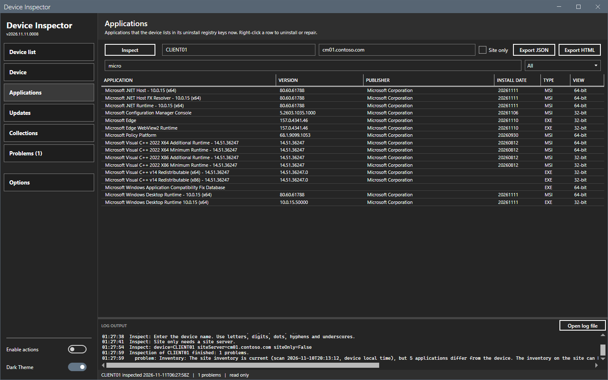
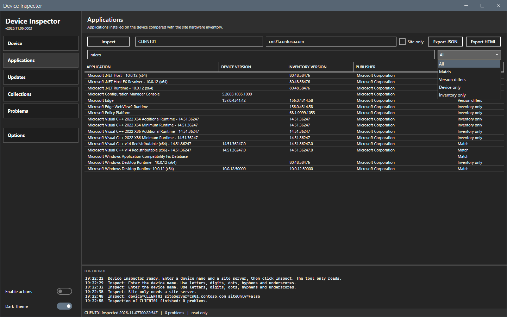
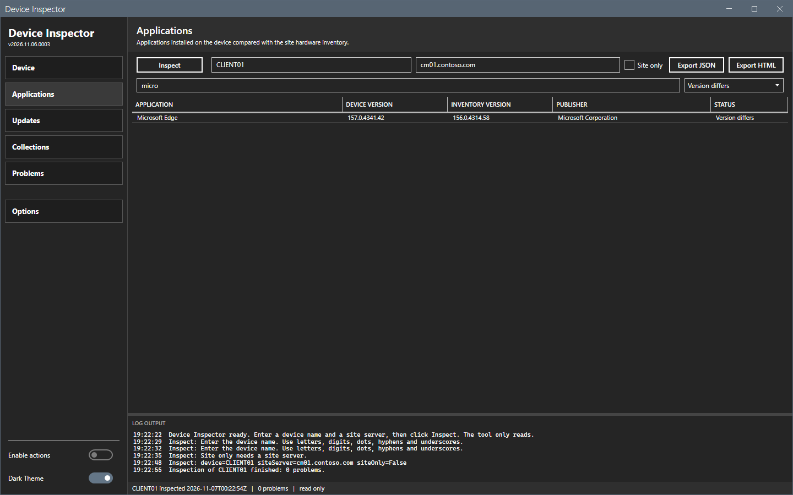
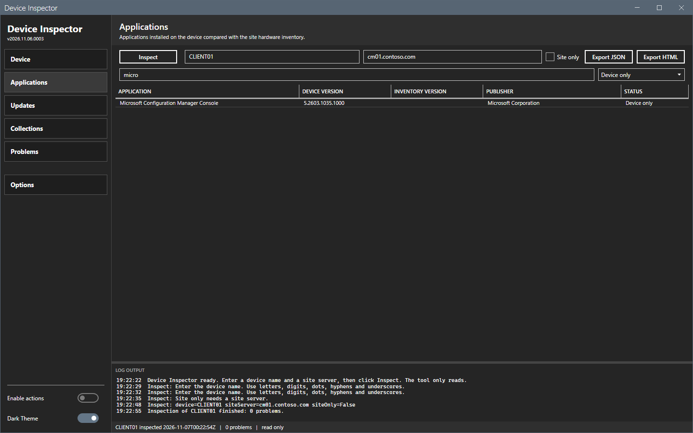

# Applications panel

The Applications panel lists the applications on the device and in the site hardware inventory, merged by name, with a status for each row.

## What it does

The device list comes from the uninstall registry keys of the device. The inventory list comes from the site hardware inventory (`Add Remove Programs` and `Add Remove Programs (64)`). The tool merges both lists by application name and compares the versions.

## When to use it

Use it to find an application that is on the device and not in the inventory, an inventory entry that the device no longer has, or a version that differs.

## Requirements

An inspection that read the device, the site or both.

## Steps

### Read the list

1. Select **Applications** in the sidebar.
2. Read one row for each application. The columns are **Application**, **Device version**, **Inventory version**, **Publisher** and **Status**.

### Filter by name

1. In the filter box (`Filter by application name...`), enter part of a name. The list shows only the matches.
2. Clear the box to show all rows.

### Filter by status

1. Open the list at the right of the filter box.
2. Select **All**, **Match**, **Version differs**, **Device only** or **Inventory only**.

The two filters work together.

### The right-click menu

A right-click on a row opens a menu with **Uninstall...** and **Repair...**. They work on a row that carries a Configuration Manager application, and need **Enable actions**. An entry that is off shows the reason as its tooltip. See [Actions](actions.md#uninstall-or-repair-an-application).

### Applications panel in the light theme

## Options and settings of this page

### Status values

| Status | Meaning |
|---|---|
| **Match** | The name and the version are equal in both lists. |
| **Version differs** | The name is equal and the version differs. |
| **Device only** | The device list has the application and the inventory does not. |
| **Inventory only** | The inventory has the application and the device does not. |
| **Client application** | A Configuration Manager application that the client on the device lists as installed, and that has no uninstall entry with the same name. The device version is the software version of the application. |

A row shows the status as text. It has no color.

## Limits

- The inventory list needs the hardware inventory classes `Add Remove Programs` and `Add Remove Programs (64)` in the client settings.
- The device list reads the machine-wide uninstall keys only. Per-user installs are not listed. Entries that Windows marks as system components (`SystemComponent` 1) are listed, because the site inventory lists them too. Names are compared without spaces at the ends.
- The inventory can lag the device. A new install shows as **Device only** until the next hardware inventory.

## Troubleshooting

| Message or symptom | Cause | Fix |
|---|---|---|
| Every row is **Device only**. | The site was not queried, or it has no matching application inventory. | If the site was not queried, enter the site server and the site code, then inspect again. Otherwise check the hardware inventory classes and the client settings. |
| Every row is **Inventory only**. | The device did not answer, or **Site only** was on. | Read the **Problems** panel. Clear **Site only**. |
| The list is empty. | No inspection yet, or both sources failed. | Select **Inspect**. |

## Links

- [How to configure hardware inventory](https://learn.microsoft.com/intune/configmgr/core/clients/manage/inventory/configure-hardware-inventory): Describes how to enable inventory classes.
