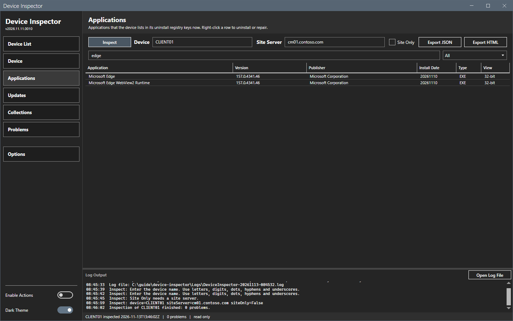
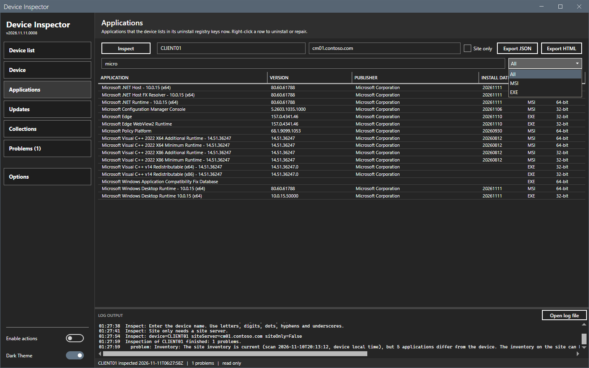
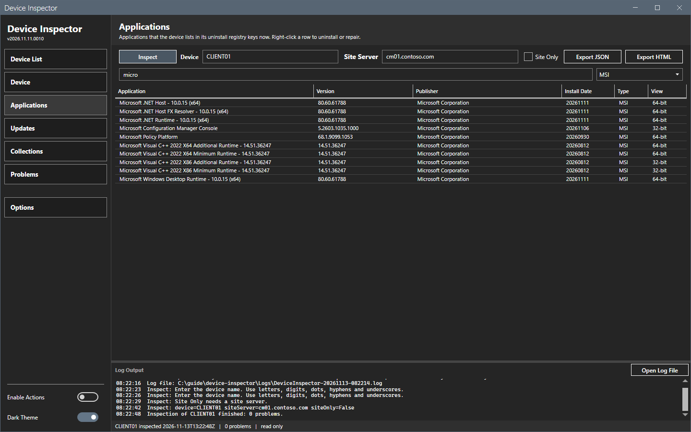
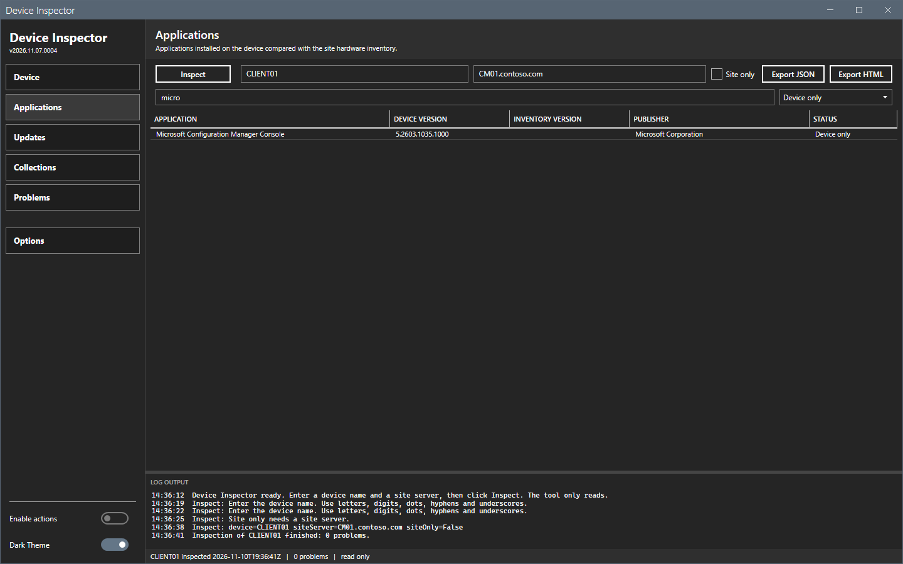
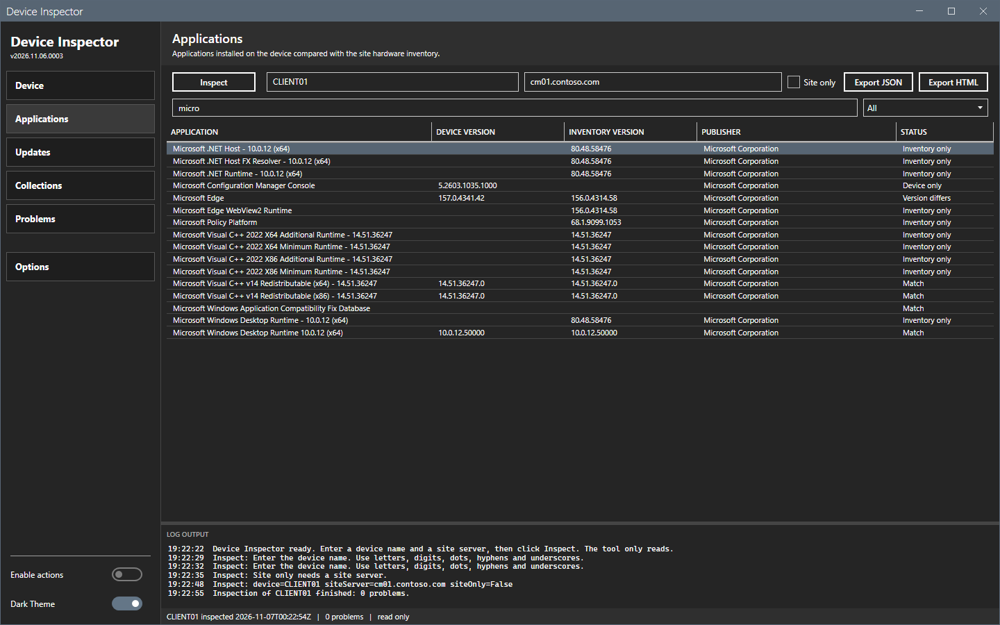
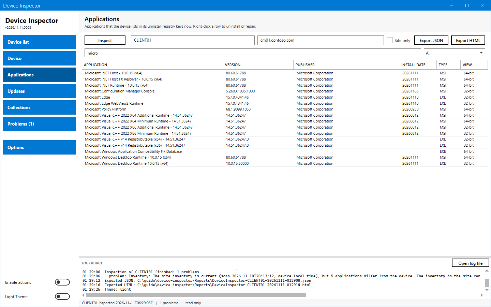

# Applications panel

The Applications panel is a live view of the uninstall registry keys of the device. It lists one row for each key. It does not compare the keys with the site inventory.

## What it does

The tool reads the machine-wide uninstall keys of the device when you inspect it. It reads two places in `HKEY_LOCAL_MACHINE`:

- `SOFTWARE\Microsoft\Windows\CurrentVersion\Uninstall` (the **64-bit** view);
- `SOFTWARE\WOW6432Node\Microsoft\Windows\CurrentVersion\Uninstall` (the **32-bit** view).

Each key that has a `DisplayName` is one row. Two keys with the same name and version stay two rows, because each key has its own product code or key name.

## When to use it

- Use it to see what the device lists as installed now.
- Use it to uninstall or repair an application from its uninstall key.

For a comparison of the site inventory with the device, see the inventory check in [Actions](actions.md#repair-a-corrupt-inventory).

## Requirements

An inspection that read the device. A site is not needed.

## Steps

### Read the list

1. Select **Applications** in the sidebar.
2. Read one row for each uninstall key. The columns are **Application**, **Version**, **Publisher**, **Install Date**, **Type** and **View**.

### Filter by name

1. In the filter box (`Filter by application name...`), enter part of a name. The list shows only the matches.
2. Clear the box to show all rows.

### Filter by type

1. Open the list at the right of the filter box.
2. Select **All**, **MSI** or **EXE**.

The two filters work together.

### The right-click menu

A right-click on a row opens a menu with **Uninstall...** and **Repair...**. They work from the uninstall key of the row and need **Enable Actions**. An entry that is off shows the reason as its tooltip. See [Actions](actions.md#uninstall-or-repair-an-application).

### Applications panel in the light theme

## Options and settings of this page

### Type values

| Type | Meaning |
|---|---|
| **MSI** | The key name is a product code in braces, and the uninstall string starts with `msiexec`, or the key has `WindowsInstaller` 1. |
| **EXE** | Every other entry. |

### When Uninstall and Repair are on

| Entry | Uninstall | Repair |
|---|---|---|
| MSI | On. | On. |
| EXE with a quiet uninstall string | On. | Off. The key has no documented repair command for this installer. |
| EXE without a quiet uninstall string | Off. The tool does not guess silent switches. | Off. |
| System component (`SystemComponent` 1) | Off. It is part of another product. | Off. |

## Limits

- The list reads the machine-wide uninstall keys only. Per-user installs (`HKEY_CURRENT_USER`) are not listed.
- Entries that Windows marks as system components (`SystemComponent` 1) are listed. Their actions are off.
- The list shows the state at the time of the inspection. Inspect again to refresh it.
- The panel does not show Configuration Manager applications from the client policy. The text report and the JSON export still hold that policy.

## Troubleshooting

| Message or symptom | Cause | Fix |
|---|---|---|
| The list is empty. | No inspection yet, or the device part failed. | Select **Inspect**. Read the **Problems** panel. |
| **Uninstall...** or **Repair...** is off. | **Enable Actions** is off, no row is selected, or the entry does not allow the action. | Hover over the entry to read the reason. |
| An application is missing from the list. | It is a per-user install, or it has no `DisplayName`. | None. The tool lists machine-wide keys with a display name only. |

## Links

- [Uninstall registry key](https://learn.microsoft.com/windows/win32/msi/uninstall-registry-key): Describes the key that Windows Installer writes under `Uninstall`.
