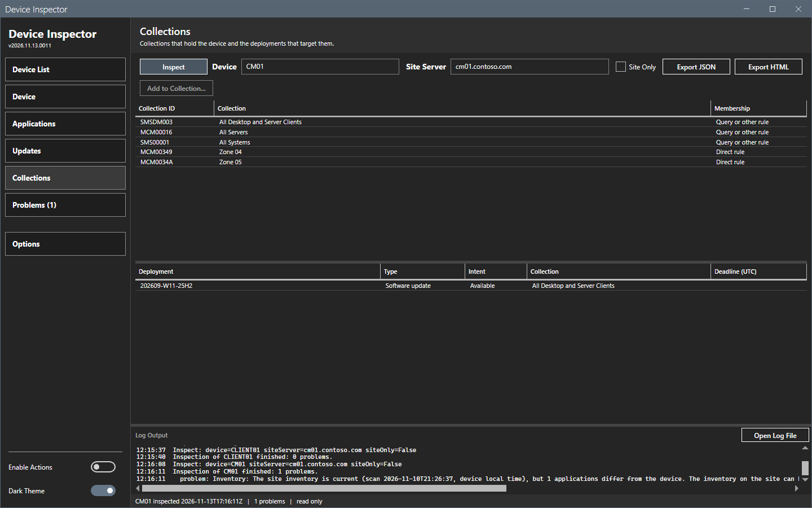

# Collections panel

The Collections panel lists the collections that hold the device and the deployments that target those collections.

## What it does

The upper grid shows each collection of the device with its ID. The lower grid shows each deployment that targets one of those collections.

## When to use it

Use it to find out why a device gets a deployment, or which collection brings it.

## Requirements

An inspection that read the site. A **Site only** inspection and a full inspection both fill the panel. An inspection with no site server leaves it empty.

## Steps

### Read the memberships and the deployments

1. Select **Collections** in the sidebar.
2. Read the upper grid: **Collection ID**, **Collection** and **Membership**.
3. Read the lower grid: **Deployment**, **Type**, **Intent**, **Collection** and **Deadline (UTC)**. The **Collection** column names the collection that brings the deployment to the device.

### The right-click menus

A right-click on a collection row opens **Remove from collection...** and **Add to collection...**. **Remove from collection...** removes the direct membership rule of the device and needs **Enable actions**. It is off, with the reason as its tooltip, for a membership through a query, include or other rule, and for a built-in collection. See [Actions](actions.md#remove-the-device-from-a-collection). **Add to collection...** is off in this release.

## Options and settings of this page

| Column | Content |
|---|---|
| **Collection ID** | The ID of the collection, for example `SMS00001`. |
| **Membership** | `Direct rule` when a direct membership rule adds the device (`IsDirect` of `SMS_FullCollectionMembership`), else `Query or other rule`. A device can have a direct rule and another rule in the same collection. |
| **Collection** | The name of the collection. |
| **Deployment** | The name of the deployment. |
| **Type** | `Application`, `Software update`, `Program`, `Configuration baseline` or another type that the site reports. |
| **Intent** | `Available` or `Required`. |
| **Deadline (UTC)** | The deadline, when one exists. |

## Limits

- The tool shows the deployments that target a collection of the device. It does not show the result of each deployment on the device.
- A collection ID from the site is checked against eight letters or digits before it enters a query.

## Troubleshooting

| Message or symptom | Cause | Fix |
|---|---|---|
| Both grids are empty. | The site has no record of the device, or the site part failed. | Read the **Problems** panel. Check the device name. |

## Links

- [Introduction to collections](https://learn.microsoft.com/intune/configmgr/core/clients/manage/collections/introduction-to-collections): Explains device collections and their members.
