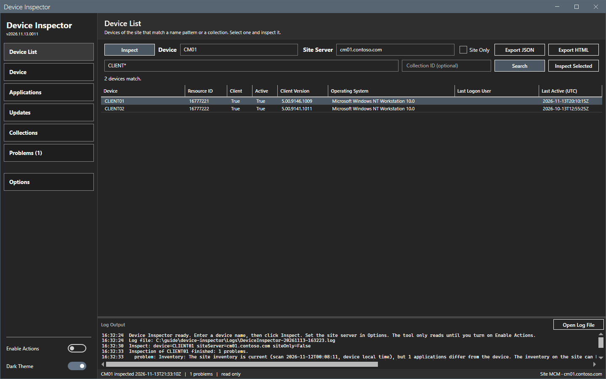

# Device List

The Device List panel finds devices on the site, by name or by collection, and inspects one of them.

## What it does

The panel reads the devices of the site with the site server of the Inspect bar and the site code of **Options**. It only reads. It shows one row for each device: the name, the resource ID, whether a client is installed and active, the client version, the operating system, the last logon user and the last active time (UTC).

## When to use it

- Use it when you know only a part of the device name.
- Use it to see the devices of one collection and to inspect one of them.

## Requirements

- A site server in the Inspect bar and a site code in **Options**.
- The rights to read devices and collections on the site. See [Permissions](../reference/permissions.md).

## Steps

### Find a device by name

1. Select **Device List** in the sidebar.
2. Enter a name or a pattern in the name box. `*` stands for any text and `?` for one character, for example `WS*`.
3. Select **Search**, or press Enter. The panel reads the site in the background.
4. Select a row, then select **Inspect Selected**, or double-click the row. The tool puts the name in the device box, opens the Device panel and inspects the device.

### List the devices of a collection

1. Enter the collection ID in the collection box, for example `SMS00001`. Leave the name box empty for all members, or enter a pattern to filter them.
2. Select **Search**.

## Options and settings of this page

| Control | Effect |
|---|---|
| Name box | A device name or a pattern with `*` and `?`. Letters, digits, hyphen, underscore and dot. |
| Collection box | Optional. An eight-character collection ID. |
| **Search** | Reads the matching devices from the site. |
| **Inspect Selected** | Inspects the selected device. On when a row is selected. |

The search reads with `Get-CMDevice -Name <pattern> -Fast`, or with `Get-CMCollectionMember -CollectionId <ID>` (and `-Name <pattern>` when a pattern is given). Members of a collection that are not systems are left out. The site drive is closed after each search.

## Limits

- The panel shows at most 500 devices. The summary line gives the total and asks you to narrow the pattern.
- A search needs a name pattern, a collection ID, or both. A name pattern without a collection needs at least one letter or digit, so that a search does not read every device of the site.
- The site returns all matching devices; the limit of 500 applies after the read.

## Troubleshooting

| Message | Cause | Fix |
|---|---|---|
| Enter a site server in the Inspect bar. ... | The site server box is empty. | Enter the site server. Set the site code in **Options**. |
| Enter a name pattern, a collection ID, or both. | Both boxes are empty. | Enter a pattern or a collection ID. |
| A name pattern without a collection needs at least one letter or digit. | The pattern is only `*` or `?`. | Add a letter or a digit, or enter a collection ID. |
| The search failed. The log file has the reason. | The site cannot be opened or read. | Check the site server, the site code and the account rights. |

## Links

- [Get-CMDevice](https://learn.microsoft.com/powershell/module/configurationmanager/get-cmdevice): Describes the device read and its name wildcards.
- [Get-CMCollectionMember](https://learn.microsoft.com/powershell/module/configurationmanager/get-cmcollectionmember): Describes the member read of a collection.
