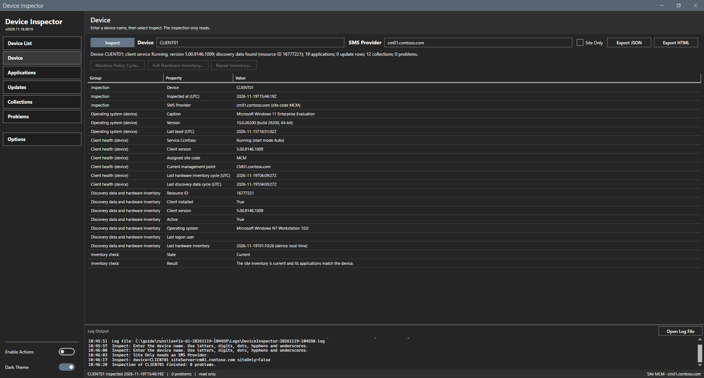
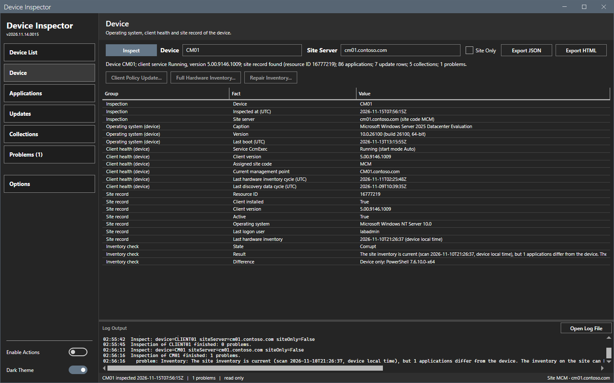
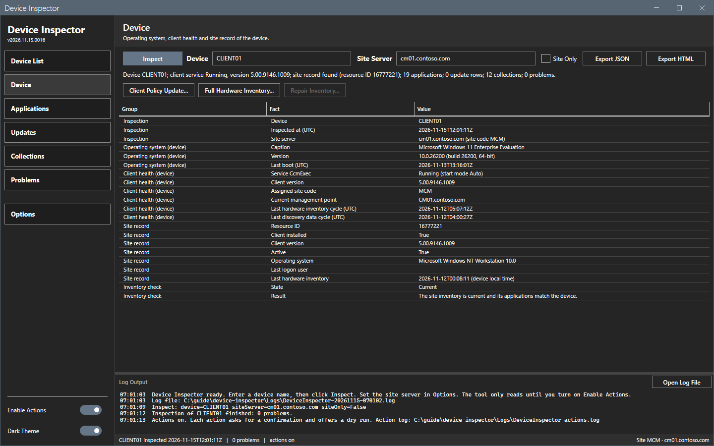
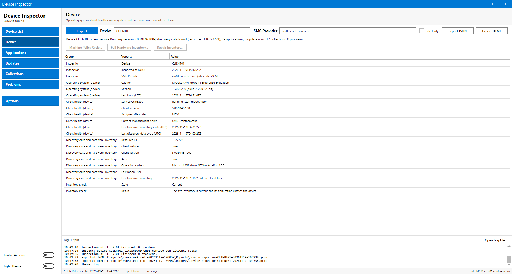
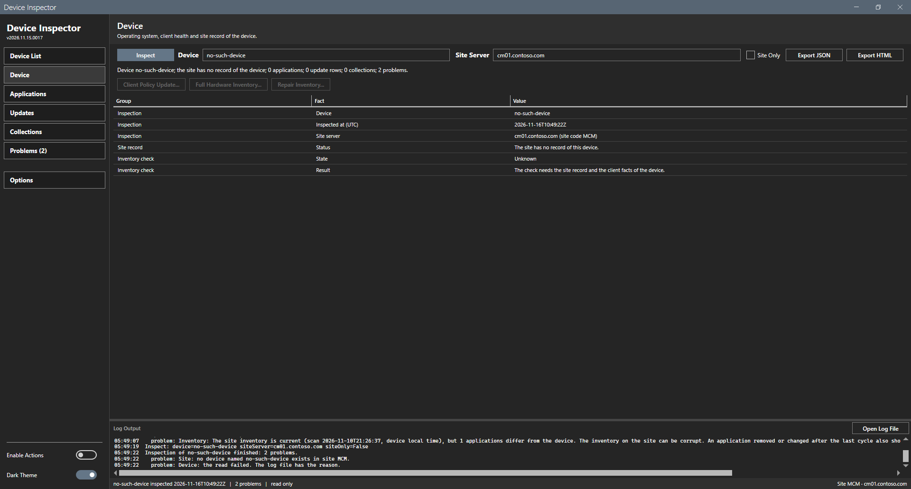

# Device panel

The Device panel shows a summary line and a table of properties of the operating system, the client health, the discovery data and the hardware inventory.

## What it does

The panel groups the properties of one device. They come from the device (operating system, client health) and from the site (discovery data and hardware inventory).

## When to use it

Use it to check that a device is healthy and that the site knows it.

## Requirements

An inspection. Before **Inspect**, the panel shows "No inspection yet." and an empty table.

## Steps

### Review the summary

1. Select **Inspect**.
2. Review the line above the table, for example: `Device WS01; client service Running, version 5.00.9146.1009; discovery data found (resource ID 16777221); 20 applications; 8 update rows; 11 collections; 0 problems.`

The line says "the site has no record of the device" when the site does not know the device.

### Review the properties

The table has three columns: **Group**, **Property** and **Value**.

| Group | Properties |
|---|---|
| Inspection | The device, the time of the inspection (UTC) and the SMS Provider with the site code. |
| Operating system (device) | The caption, the version with the build and the architecture, and the last boot time (UTC). |
| Client health (device) | The state and the start mode of the `CcmExec` service, the client version, the assigned site code, the current management point, and the last Hardware Inventory Cycle and the last Discovery Data Collection Cycle (UTC). |
| Discovery data and hardware inventory | From `Get-CMDevice` and the hardware inventory class `SMS_G_System_WORKSTATION_STATUS`: the resource ID, whether the client is installed, the client version, whether the device is active, the operating system, the last logon user and the last hardware inventory time. |

The **Last hardware inventory** property of the **Discovery data and hardware inventory** group is the last hardware inventory time of the site (`LastHWScan` of `SMS_G_System_WORKSTATION_STATUS`). The value ends with "(device local time)". The site stores this time as the local clock time of the device, with no zone, and the tool does not convert it. The inventory check uses the same value.

If the site has no row in that class for the device, the property shows the `Get-CMDevice` value in UTC. The value then ends with "(UTC, from Get-CMDevice; can lag a processed report)". On the lab on 2026-11-10 the `Get-CMDevice` value kept the date of an older report for hours after the site loaded a new full report. Microsoft Learn does not document why. The JSON export names the source in `LastHardwareInventorySource`.

Two "last hardware inventory" values exist on purpose. The device value is the start time of the last Hardware Inventory Cycle on the client. The site value is the last hardware inventory time that the site stored. They can differ.

### The action buttons

Under the summary line, three buttons start actions on the device: **Machine Policy Cycle...**, **Full Hardware Inventory...** and **Repair Inventory...**. They are off until **Enable Actions** is on and an inspection reached the device. **Repair Inventory...** is on only when the inventory check says **Corrupt**. A button that is off while an action runs on the device shows the reason as its tooltip. See [Actions](actions.md).

### Device panel in the light theme

### A device that does not answer

When the tool cannot reach the device, the **Device** groups are missing and the **Problems** panel names the cause.

## Options and settings of this page

None.

## Inventory check

The group **Inventory check** shows the state of the site inventory against the device: **Current**, **Corrupt**, **NotCurrent** or **Unknown**, the result text, and one row **Difference** for each application that differs. See [Actions](actions.md#repair-a-corrupt-inventory).

## Limits

- The last logon user is empty when the site has no value for it.
- A date is in UTC, format `yyyy-MM-ddTHH:mm:ssZ`.

## Troubleshooting

| Message or symptom | Cause | Fix |
|---|---|---|
| The device groups are missing. | **Site Only** was on, or the device did not answer. | Clear **Site Only**. Review the **Problems** panel. |
| The **Discovery data and hardware inventory** group is missing. | The SMS Provider was empty, or the site has no device with this name. | Set the SMS Provider in **Options**. Check the device name. |

## Links

- [How to monitor clients in Configuration Manager](https://learn.microsoft.com/intune/configmgr/core/clients/manage/monitor-clients): Explains how the site judges client health.
- [SMS_G_System_WORKSTATION_STATUS Server WMI Class](https://learn.microsoft.com/intune/configmgr/develop/reference/core/clients/manage/sms_g_system_workstation_status-server-wmi-class): Describes `LastHardwareScan`, the source of the Last hardware inventory property. The page does not state the zone of the value.
- [Get-CMDevice](https://learn.microsoft.com/powershell/module/configurationmanager/get-cmdevice): Describes the device object. The page does not explain why its `LastHardwareScan` can lag.
