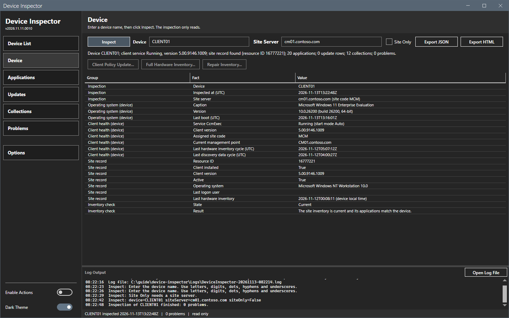
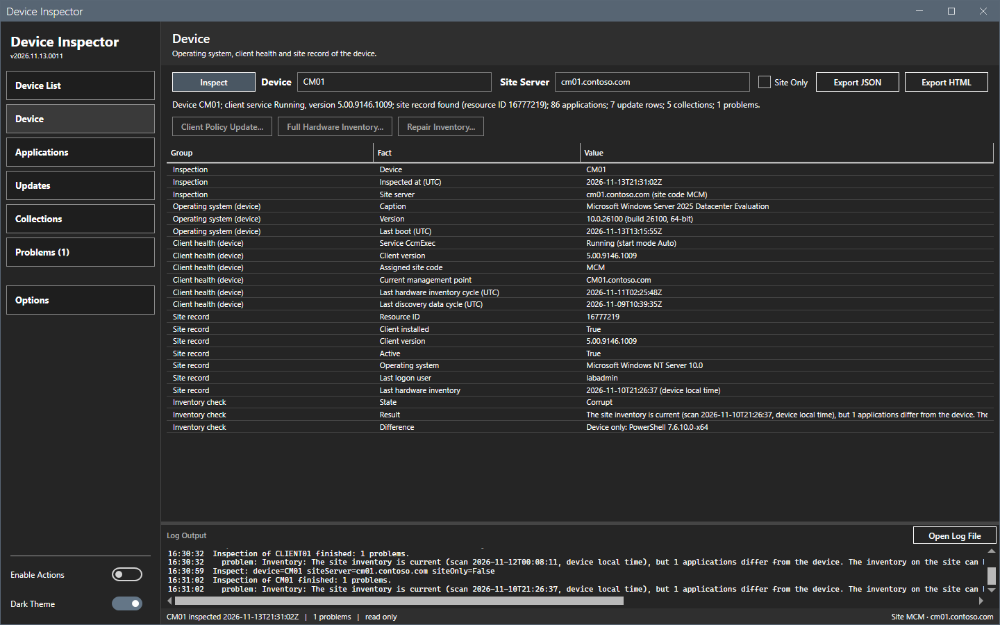
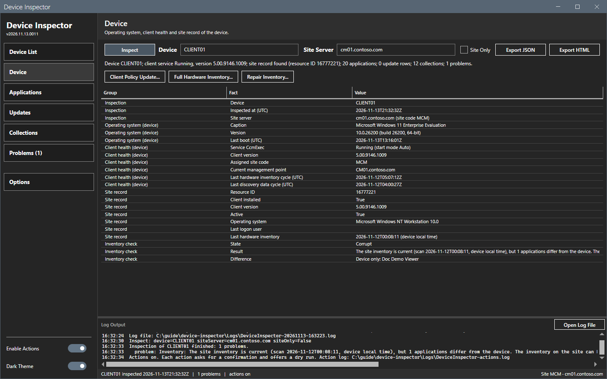
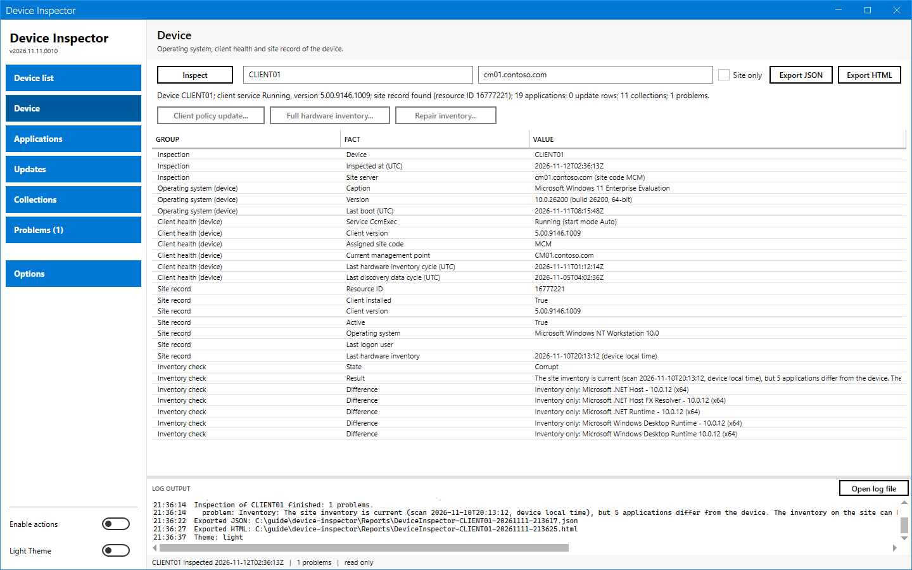
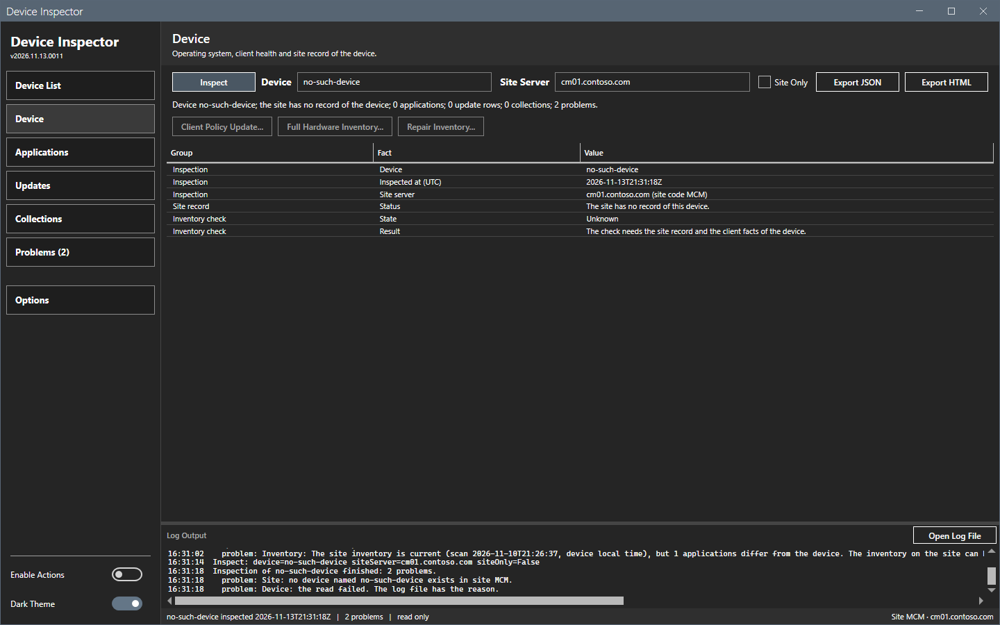

# Device panel

The Device panel shows a summary line and a table of facts about the operating system, the client health and the site record.

## What it does

The panel groups the facts of one device. The facts come from the device (operating system, client health) and from the site (site record).

## When to use it

Use it to check that a device is healthy and that the site knows it.

## Requirements

An inspection. Before **Inspect**, the panel shows "No inspection yet." and an empty table.

## Steps

### Read the summary

1. Select **Inspect**.
2. Read the line above the table, for example: `Device WS01; client service Running, version 5.00.9146.1009; site record found (resource ID 16777221); 20 applications; 8 update rows; 11 collections; 0 problems.`

The line says "the site has no record of the device" when the site does not know the device.

### Read the facts

The table has three columns: **Group**, **Fact** and **Value**.

| Group | Facts |
|---|---|
| Inspection | The device, the time of the inspection (UTC) and the site server with the site code. |
| Operating system (device) | The caption, the version with the build and the architecture, and the last boot time (UTC). |
| Client health (device) | The state and the start mode of the `CcmExec` service, the client version, the assigned site code, the current management point, and the last hardware inventory cycle and the last discovery data cycle (UTC). |
| Site record | The resource ID, whether the client is installed, the client version, whether the device is active, the operating system, the last logon user and the last hardware inventory date. |

The **Last hardware inventory** fact of the site record is the scan time of the site inventory record (`SMS_G_System_WORKSTATION_STATUS`). The fact ends with "(device local time)". The site stores this time as the local clock time of the device, with no zone, and the tool does not convert it. The inventory check uses the same value.

If the site has no row in that class for the device, the fact shows the `Get-CMDevice` value in UTC. The fact then ends with "(UTC, from Get-CMDevice; can lag a processed report)". On the lab on 2026-11-10 the `Get-CMDevice` value kept the date of an older report for hours after the site loaded a new full report. Microsoft Learn does not document why. The JSON export names the source in `LastHardwareInventorySource`.

Two "last hardware inventory" values exist on purpose. The device value is the start time of the last cycle on the client. The site value is the scan date that the site stored. They can differ.

### The action buttons

Under the summary line, three buttons start actions on the device: **Client policy update...**, **Full hardware inventory...** and **Repair inventory...**. They are off until **Enable actions** is on and an inspection reached the device. **Repair inventory...** is on only when the inventory check says **Corrupt**. A button that is off while an action runs on the device shows the reason as its tooltip. See [Actions](actions.md).

### Device panel in the light theme

### A device that does not answer

When the tool cannot reach the device, the **Device** groups are missing and the **Problems** panel names the cause.

## Options and settings of this page

None.

## Inventory check

The group **Inventory check** shows the state of the site inventory against the device: **Current**, **Corrupt**, **NotCurrent** or **Unknown**, the result text, and one row **Difference** for each application that differs. See [Actions](actions.md#repair-a-corrupt-inventory).

## Limits

- The last logon user is empty when the site has no value for it.
- A date is in UTC, format `yyyy-MM-ddTHH:mm:ssZ`.

## Troubleshooting

| Message or symptom | Cause | Fix |
|---|---|---|
| The device groups are missing. | **Site only** was on, or the device did not answer. | Clear **Site only**. Read the **Problems** panel. |
| The site record is missing. | The site server box was empty, or the site has no record. | Enter the site server. Check the device name. |

## Links

- [How to monitor clients in Configuration Manager](https://learn.microsoft.com/intune/configmgr/core/clients/manage/monitor-clients): Explains how the site judges client health.
- [SMS_G_System_WORKSTATION_STATUS Server WMI Class](https://learn.microsoft.com/intune/configmgr/develop/reference/core/clients/manage/sms_g_system_workstation_status-server-wmi-class): Describes `LastHardwareScan`, the source of the Last hardware inventory fact. The page does not state the zone of the value.
- [Get-CMDevice](https://learn.microsoft.com/powershell/module/configurationmanager/get-cmdevice): Describes the device record. The page does not explain why its `LastHardwareScan` can lag.
