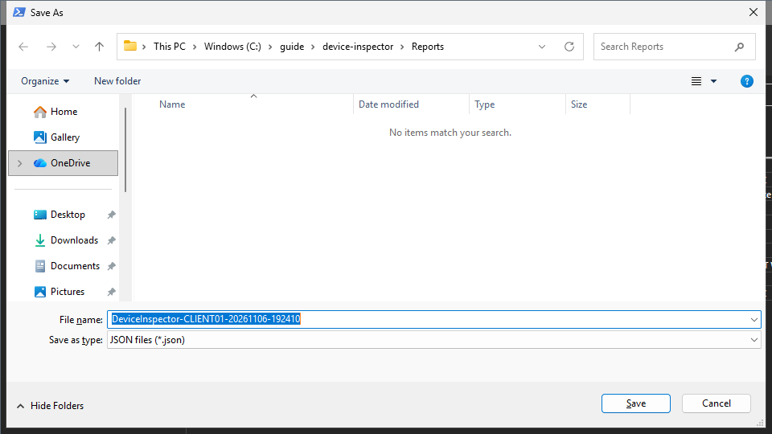
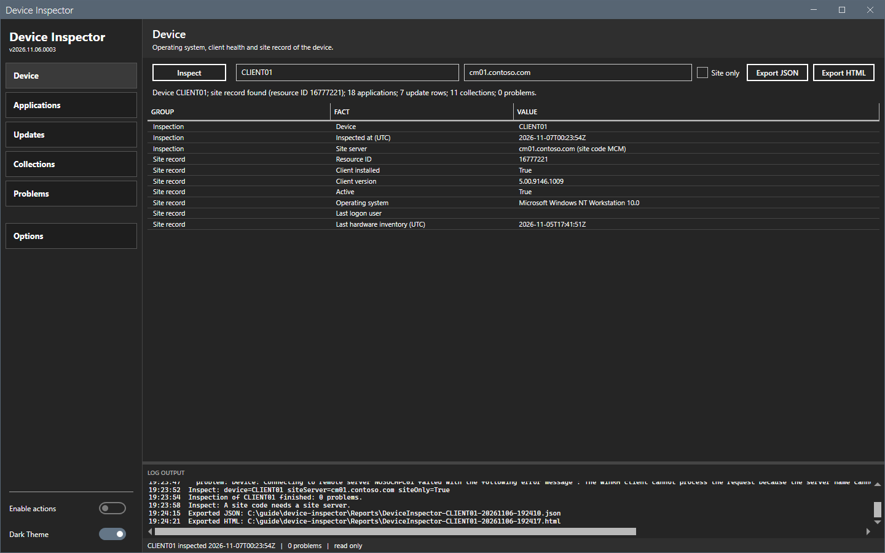

# Export

Export JSON and Export HTML save the inspection to a file.

## What it does

**Export JSON** writes all facts of the inspection as JSON (UTF-8 without a byte order mark, dates in ISO 8601 UTC). **Export HTML** writes a self-contained report page.

## When to use it

- Use the JSON file to keep the facts or to process them in a script.
- Use the HTML file to share the facts with a person.

## Requirements

An inspection. Before **Inspect**, both buttons are off.

## Steps

### Export an inspection

1. Select **Inspect** and wait for the result.
2. Select **Export JSON** or **Export HTML**. The buttons are at the right end of the Inspect bar.
3. In the **Save As** dialog, keep the name `DeviceInspector-<device>-<yyyyMMdd-HHmmss>` or enter another. The dialog opens in the `Reports` folder.
4. Select **Save**. The log writes "Exported JSON:" (or HTML) and the path.

Select **Cancel** in the dialog to stop. The tool writes nothing.

## Options and settings of this page

| Button | File | Content |
|---|---|---|
| **Export JSON** | `.json` | All facts, with every list entry. |
| **Export HTML** | `.html` | One page with the same facts. The page has no script and no external resource. |

## Limits

- The files hold the facts of the last inspection. A change of the boxes does not change them.
- The HTML page lists the entries of the lists that it shows. It omits the client application policy entries of the device, with their install and evaluation states. Use the JSON file for the complete inspection. The command-line report defaults to at most 25 entries in each of the collections, deployments, updates and applications lists. Use `-MaximumListedItems` to change this. See [Command line](command-line.md).

## Troubleshooting

| Message | Cause | Fix |
|---|---|---|
| Export JSON failed: ... (dialog **Export**) | The tool could not write the file. | Choose a folder that your account can write to. When the `Reports` folder does not exist and the tool cannot create it, make the application folder writable, or ask an administrator to create the `Reports` folder beside the script. Then export again. |

## Links

None.
