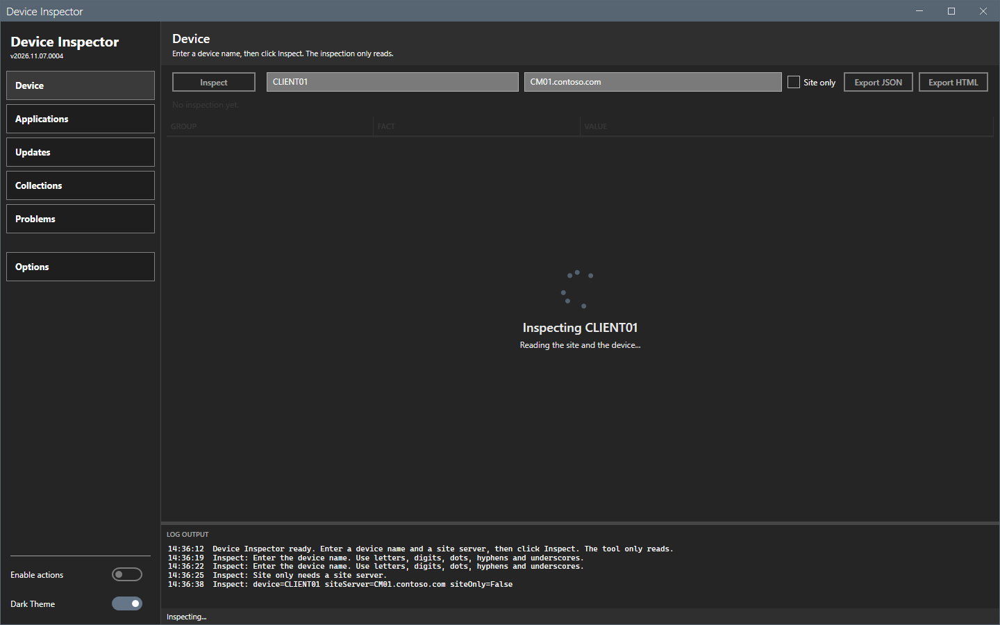
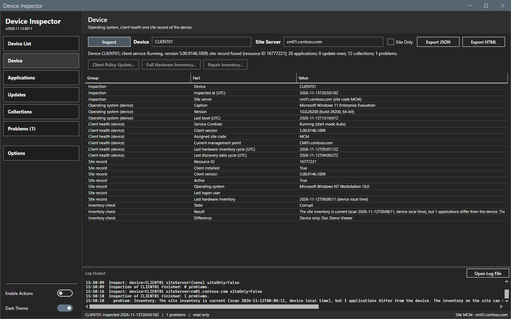
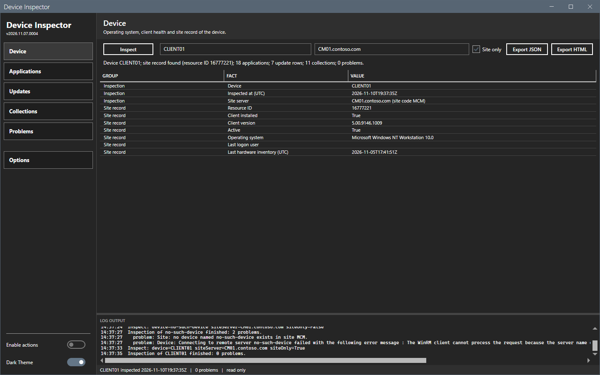
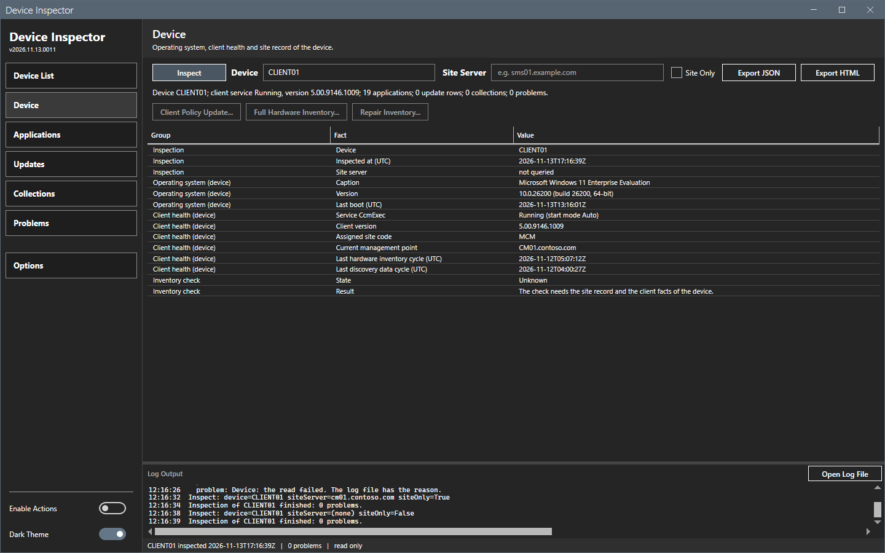
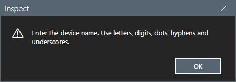
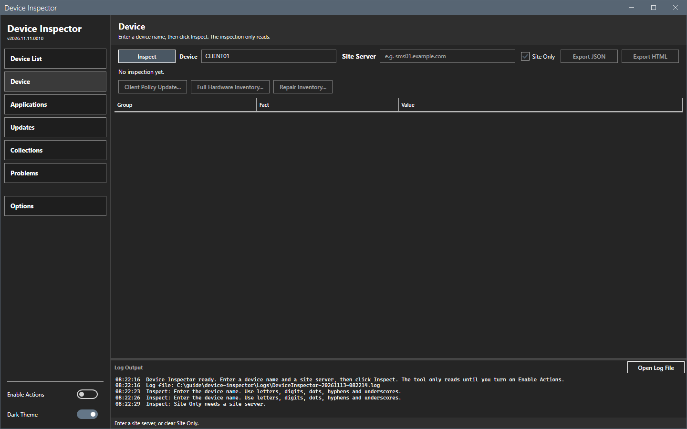

# Inspect bar

The Inspect bar is the row above every panel. It holds the device name, the site server, Site Only, Inspect and the two export buttons.

## What it does

**Inspect** reads the device and the site and fills the five panels of the device. Nothing changes on the site or on the device.

## When to use it

Use it each time you want the facts of a device, or when you want them again after a change.

## Requirements

- A device name.
- A site server and its site code (set in **Options**), unless you want only the device facts.
- The rights in [Permissions](../reference/permissions.md).

## Steps

### Inspect a device

1. In the first box, enter the device name. Use letters, digits, dots, hyphens and underscores.
2. Check the second box. It shows the site server from **Options** as read-only text. To change it, select **Options**. The footer shows the same site server and the site code at the right end: `Site XYZ · sms01.example.com`.
3. Select **Inspect**. You can also press Enter in the device box.
4. Wait for the overlay to end. The log writes "Inspection of <device> finished: <n> problems." and the status bar shows the device, the time and the problem count.

The summary line on the **Device** panel counts the applications, the update rows, the collections and the problems.

### Read only the site

1. Select **Site Only**.
2. Select **Inspect**. The tool does not contact the device. The device groups are missing from the **Device** panel.

### Read only the device

1. In **Options**, clear the site server and the **Site Code**, then select **OK**. The site server box on the Inspect bar is then empty. With a site code left in **Options**, **OK** opens the message "A site code needs a site server." and the dialog stays open. The site server box on the Inspect bar is read-only. You change the site server only in **Options**.
2. Clear **Site Only** and enter a valid device name.
3. Select **Inspect**. The tool does not contact the site. The site record is missing from the **Device** panel, and the Site server row says "not queried".

### Checks before the run

The tool checks the boxes before it reads anything. A wrong value opens a message and stops the run.

**Site Only** with no site server does not open a message. The log writes "Inspect: Site Only needs a site server." and the status bar shows "Set a site server in Options, or clear Site Only."

## Options and settings of this page

| Control | Effect |
|---|---|
| Device box | The device name. The watermark shows `Device name, e.g. WS01`. |
| Site server box | The SMS Provider computer from **Options**. The box is read-only. When it is empty, the watermark shows `Set in Options`. |
| **Site Only** | Skips the connection to the device. |
| **Inspect** | Reads the device and the site. |
| **Export JSON**, **Export HTML** | Save the inspection. See [Export](export.md). They turn on when an inspection exists. |

The site code comes from **Options**. It is required whenever a site server is set. The tool saves the device name and **Site Only** when you select **Inspect** with valid inputs. It saves the site server on **Inspect** only when the box is not empty, and when you select **OK** in Options.

The **Enable Actions** switch at the bottom of the sidebar is off at each start. While it is off, the tool only reads. See [Actions](actions.md).

## Limits

- The tool inspects one device at a time.
- A device name that has several resource records in the site uses the first record and adds a problem line.

## Troubleshooting

| Message | Cause | Fix |
|---|---|---|
| Enter the device name. Use letters, digits, dots, hyphens and underscores. | The trimmed name is empty, is longer than 255 characters, starts with a dot or holds another character. | Enter 1 to 255 letters, digits, dots, hyphens or underscores. Do not start with a dot. |
| The site server is a computer name or an FQDN. | The site server box holds another character. | Enter a computer name or an FQDN. |
| A site code needs a site server. | A site code is set in Options and the site server is empty. | Set a site server in **Options**, or clear the site code. |
| A site server needs a site code. Enter it in Options. | The site server box holds a value and Options holds no site code. | Enter the site code in **Options**. |

## Links

- [Windows Remote Management](https://learn.microsoft.com/windows/win32/winrm/portal): Describes WinRM, which the tool uses for the device.
