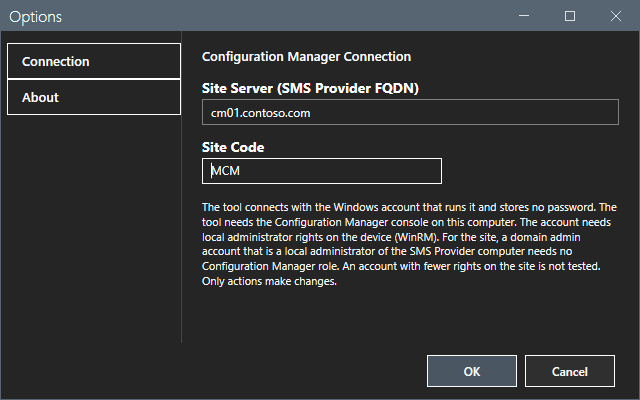
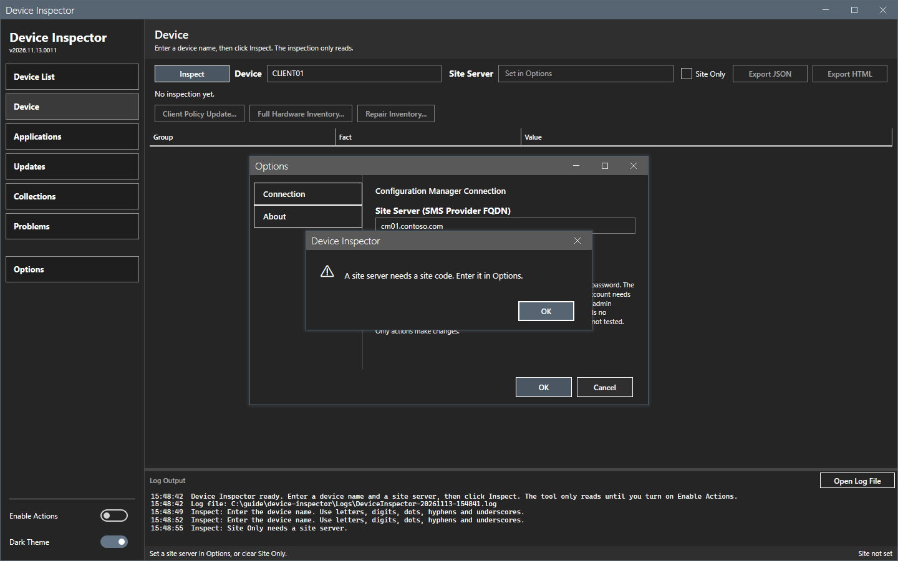
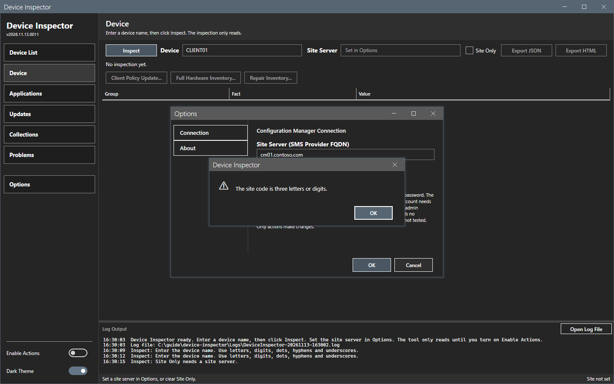
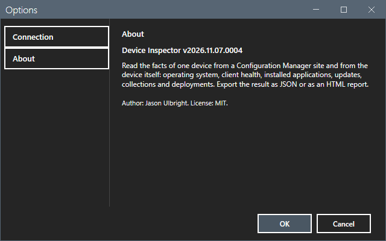
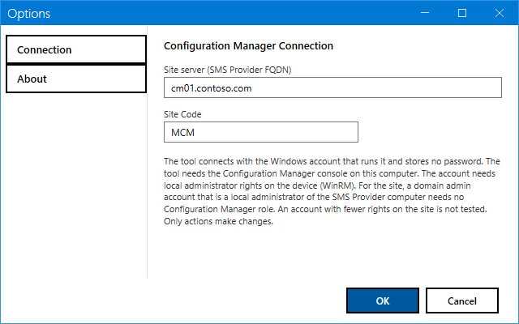

# Options dialog

The Options dialog sets the connection and shows the version of the tool.

## What it does

The dialog has two sections, **Connection** and **About**. **Connection** holds the site server and the site code. **About** shows the version, a description, the author and the license.

## When to use it

Use it to set the site server once, or to set a site code.

## Requirements

None. The dialog does not connect to the site.

## Steps

### Set the connection

1. Select **Options** in the sidebar.
2. Select **Connection**.
3. In **Site Server (SMS Provider FQDN)**, enter a computer name or an FQDN. The empty box shows the hint `e.g. sms01.example.com`.
4. In **Site Code**, enter the three letters or digits of the site code, for example `XYZ`. The empty box shows the hint `e.g. XYZ. Required with a site server.` The site code is required when a site server is set.
5. Select **OK**. The tool saves the two values and copies the site server to the site server box of the Inspect bar. Select **Cancel** or press Esc to discard the change.

**OK** checks the two values first. When a value is wrong, a message box with the title **Device Inspector** opens, and the dialog stays open. The message box has a title that differs from the dialog title, so that you do not mix up the two windows. The message box shows one line for each wrong value:

- A site code of another form.
- A site server with no site code.
- A site code with no site server.
- A site server that holds a character other than letters, digits, dots, hyphens and underscores.

Select **OK** in the message box, correct the value, and select **OK** in the dialog again.

### Read the version

1. Select **About**.
2. Read the version, for example `Device Inspector v2026.11.07.0004`. The section also shows a description of the tool and the line "Author: Jason Ulbright. License: MIT.".

### Options in the light theme

## Options and settings of this page

| Control | Default | Effect |
|---|---|---|
| **Site Server (SMS Provider FQDN)** | Empty, or the value that the suite launcher hands over | The SMS Provider computer. The site server box on the Inspect bar starts with this value. |
| **Site Code** | Empty, or the value that the suite launcher hands over | A three-character site code. Required with a site server. The tool no longer asks the provider for it. |

The text under the boxes says that the tool connects with the Windows account that runs it and stores no password, that the tool needs the Configuration Manager console on this computer, that the account needs local administrator rights on the device (WinRM), and that a domain admin account that is a local administrator of the SMS Provider computer needs no Configuration Manager role, that an account with fewer rights on the site is not tested, and that the tool only reads. The rights statement was tested on the lab only. For another account, check the Configuration Manager roles and scopes in your site. An account with other rights is not tested.

## Limits

- The dialog has no credential field. To use another account, start the tool as that account.
- A site code needs a site server. See [Inspect bar](inspect.md).

## Troubleshooting

Each message opens in a message box with the title **Device Inspector**.

| Message | Cause | Fix |
|---|---|---|
| The site code is three letters or digits. | The site code has another form. | Enter three letters or digits. |
| A site server needs a site code. Enter it in Options. | The site server is set and the site code is empty. | Enter the site code. |
| A site code needs a site server. | The site code is set and the site server is empty. | Enter the site server, or clear the site code. |
| The site server is a computer name or an FQDN. | The site server holds another character. | Enter a computer name or an FQDN. |

## Links

- [Plan for the SMS Provider](https://learn.microsoft.com/intune/configmgr/core/plan-design/hierarchy/plan-for-the-sms-provider): Explains what the SMS Provider is.
