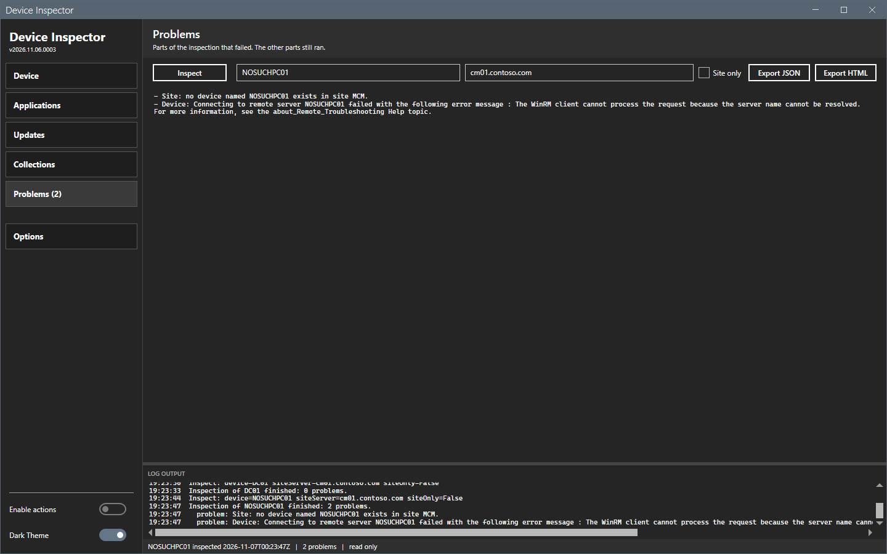
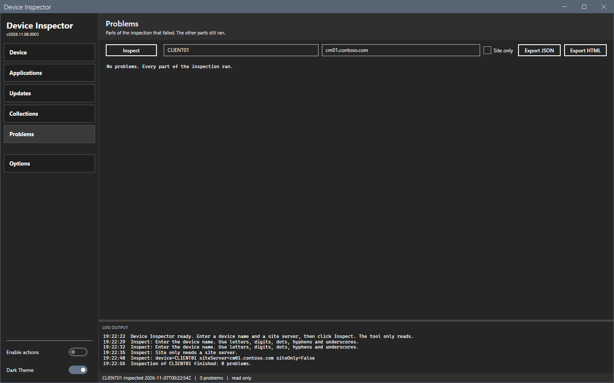
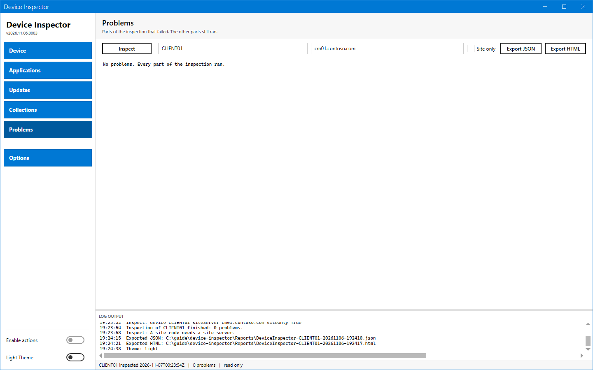

# Problems panel

The Problems panel lists the parts of the inspection that failed. The other parts still ran.

## What it does

The tool reads many parts: the operating system, the client health, the applications, the pending updates, the site record, the inventory, the memberships, the deployments and the required updates. A failed part adds one line here. The other panels show what the other parts returned.

## When to use it

Use it when a panel is empty or incomplete.

## Requirements

An inspection.

## Steps

### Read the problems

1. Look at the **Problems** entry of the sidebar. It shows the count, for example **Problems (2)**. With no problem, it shows **Problems**.
2. Select **Problems**.
3. Read one line for each problem. A line starts with `Site:` or `Device:`, or with the name of the part.

The same lines are in the log, each with the word `problem:`.

With no problem, the panel says "No problems. Every part of the inspection ran."

### Problems in the light theme

## Options and settings of this page

### Messages of the parts

| Line starts with | Meaning |
|---|---|
| `Site: no device named <name> exists in site <code>.` | The site has no resource with that name. |
| `Site: <n> resource records share the name <name>. The first one is used.` | Several records have the same name. |
| `Device: Connecting to remote server <name> failed ...` | The device did not answer. The text is the WinRM error. |
| `Operating system:`, `Client details:`, `Installed applications:`, `Client application policy:`, `Pending updates:` | One part of the device read failed. |
| `Client health: the CcmExec service does not exist.` | The device has no ConfigMgr client. |
| `Site hardware inventory date:`, `Site installed applications (<class>):`, `Site collection membership:`, `Site collection names:`, `Site deployments:`, `Site required updates:` | One part of the site read failed. |

## Limits

- The panel lists the text of the error as the site or WinRM gives it.

## Troubleshooting

| Message | Cause | Fix |
|---|---|---|
| The WinRM client cannot process the request because the server name cannot be resolved. | The device name is wrong or the name does not resolve. | Check the name and the DNS. |
| Access is denied. | The account has no remote management right on the device, or no read right on the site. | Run the tool as an account with the rights in [Permissions](../reference/permissions.md). |

## Links

- [about_Remote_Troubleshooting](https://learn.microsoft.com/powershell/module/microsoft.powershell.core/about/about_remote_troubleshooting): Describes how to fix remoting errors.
