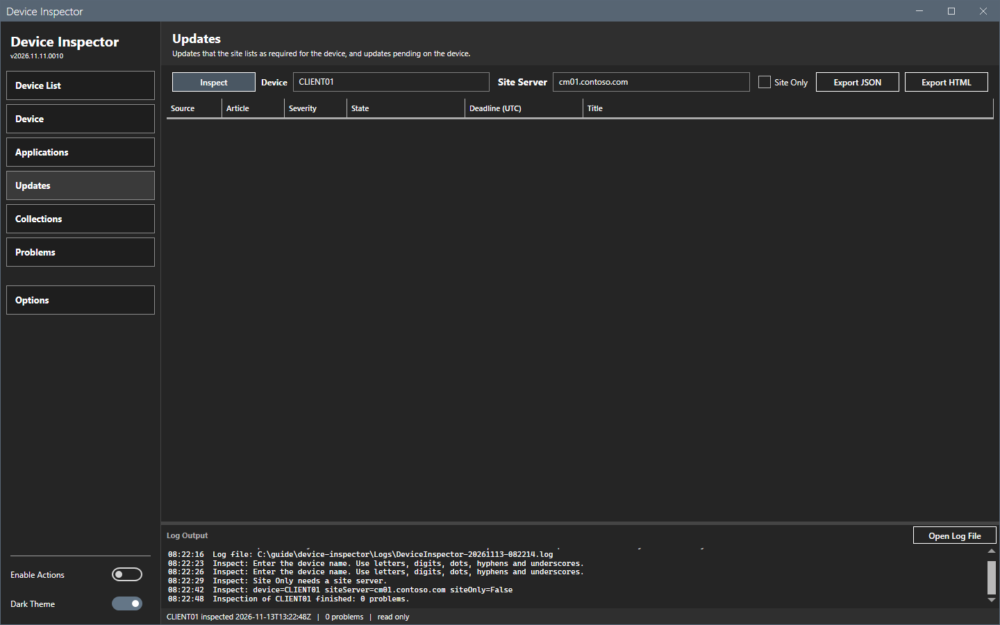
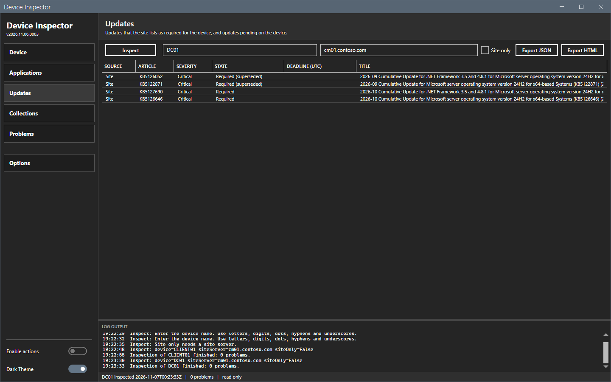
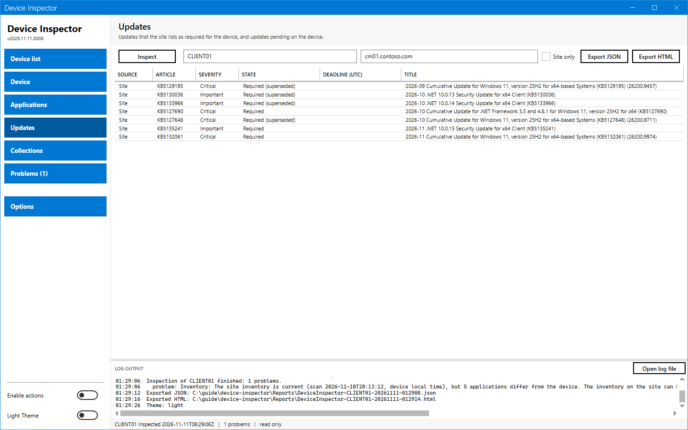

# Updates panel

The Updates panel lists the updates that the site requires for the device and the updates that are pending on the device.

## What it does

A row from the site (**Site**) comes from the update compliance status of the site. A row from the device (**Device**) comes from the pending updates in the client policy.

## When to use it

Use it to see which updates a device still needs, and which of them the client already knows.

## Requirements

An inspection that read the site, the device or both.

## Steps

### Read the list

1. Select **Updates** in the sidebar.
2. Read the columns: **Source**, **Article**, **Severity**, **State**, **Deadline (UTC)** and **Title**.

A **Site** row with the state `Required (superseded)` is an update that a newer update replaces. The site still lists it. Expired updates are left out.

A **Device** row has the evaluation state of the client, for example `None`. The severity and the deadline are empty when the client policy has no value.

### Updates panel in the light theme

## Options and settings of this page

| Column | Content |
|---|---|
| **Source** | `Site` or `Device`. |
| **Article** | `KB` and the article ID. |
| **Severity** | The severity from the site. Empty for a device row. |
| **State** | `Required`, `Required (superseded)` or the evaluation state on the device. |
| **Deadline (UTC)** | The deadline, when one exists. |
| **Title** | The update title. |

The grid is read only. The panel has no right-click menu that works. The entry **Install pending updates** in the grid menu is off in this release.

## Limits

- The updates that the site lists as required come from the update compliance status of the site. They can lag the state on the device.
- The panel shows no per-device result of a deployment.

## Troubleshooting

| Message or symptom | Cause | Fix |
|---|---|---|
| Only **Device** rows show. | **Site only** was off and the site part failed, or the site server box was empty. | Read the **Problems** panel. Enter the site server. |
| Only **Site** rows show. | **Site only** was on, or the device did not answer. | Clear **Site only**. Read the **Problems** panel. |

## Links

- [Software updates compliance](https://learn.microsoft.com/intune/configmgr/sum/deploy-use/monitor-software-updates): Describes how the site reports update compliance.
