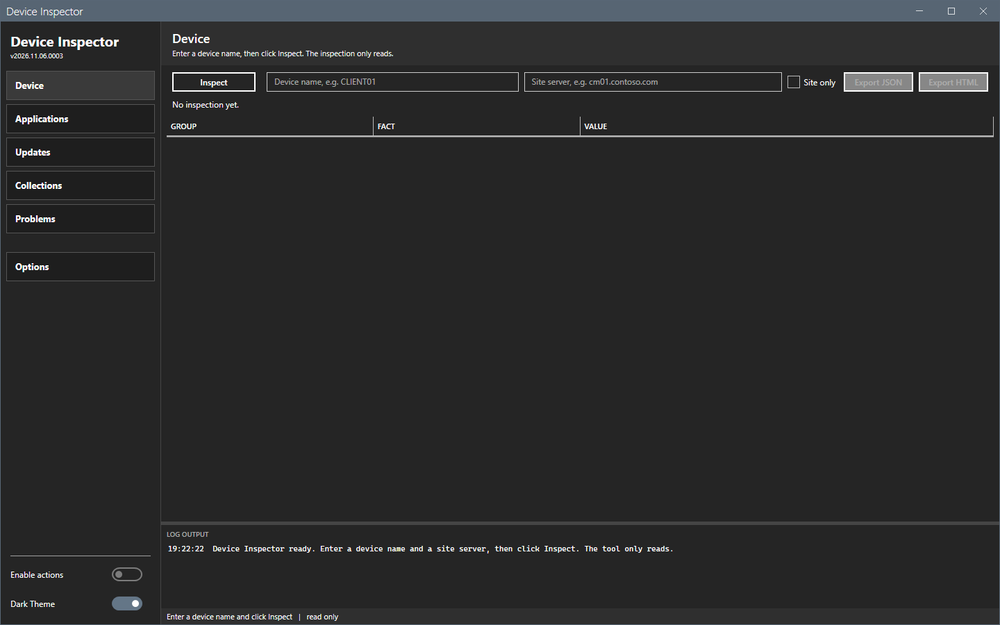
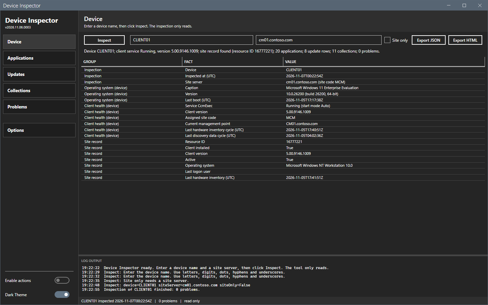
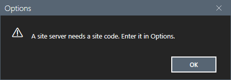
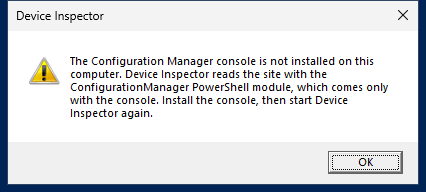
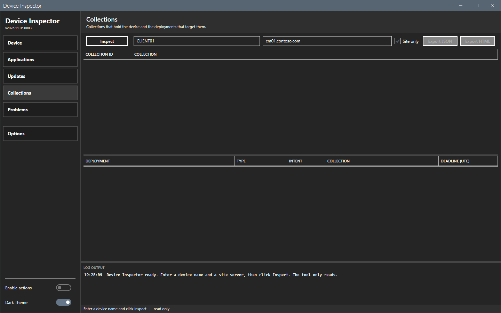

# Getting started

This page shows how to install Device Inspector, set the site server, and inspect the first device.

## What it does

Device Inspector shows one device in five panels: Device, Applications, Updates, Collections and Problems. It reads the site with `SELECT` queries and reads the device with one remote script block. It never changes the site or the device.

## When to use it

Use this page on a new installation, or when you connect the tool to a different site.

## Requirements

- Windows 10, Windows 11 or Windows Server 2016 or later.
- Windows PowerShell 5.1. PowerShell 7 also works for the command-line script.
- .NET Framework 4.7.2 or later.
- WinRM access from this computer to the device and to the SMS Provider computer.
- A Windows account with local administrator rights on the device (WinRM). For the site, a domain admin account that is a local administrator of the SMS Provider computer needs no Configuration Manager role. An account with fewer rights on the site is not tested.
- The Configuration Manager console on this computer. The tool reads the site with the ConfigurationManager PowerShell module, which comes only with the console. Without the console, the tool stops at start with a message (see below). A device-only inspection needs the module too, because the start check runs first.
- A window of at least 1024 by 640 pixels. The window opens at 1320 by 820.

The tool connects with the Windows account that runs it. It stores no password and has no credential field.

## Steps

### Install

1. Download `DeviceInspector-<version>.zip` from the Releases page of the project.
2. Extract the zip to a folder that your account can write to. The tool writes its files next to the script.
3. Start the tool from a PowerShell prompt in the folder:

   ```powershell
   powershell -ExecutionPolicy Bypass -File start-deviceinspector.ps1
   ```

   You can also right-click `start-deviceinspector.ps1` and select **Run with PowerShell**.



The status bar says "Enter a device name and click Inspect | read only". The version shows under the title in the sidebar.

### Inspect the first device

1. Select **Options**. Enter the site server (the SMS Provider computer), for example `cm01.contoso.com`, and the site code, for example `MCM`. Select **OK**. See [Options dialog](core/options.md).
2. In the first box, enter the device name, for example `CLIENT01`.
3. Check that the second box holds the site server.
4. Select **Inspect**. A progress overlay shows "Connecting...", then "Reading the site and the device...".
5. Read the summary line and the table on the **Device** panel.



A site server with no site code stops the run: a message says "A site server needs a site code. Enter it in Options.".



The sidebar shows five panels. See [Inspect bar](core/inspect.md) for every control.

### Leave one source out

- To read only the device, leave the site server empty.
- To read only the site, select **Site only**.

The tool keeps the device name, the site server and **Site only** for the next start.

### Start the tool on a computer without the console

The tool checks for the console at start. When the ConfigurationManager module is not found, a message box says so and the tool ends. Install the console, then start the tool again.



### Start the tool again

The tool keeps the device name, the site server and the settings. It does not keep the inspection. The window opens on the panel that was open when you closed it.



## Options and settings of this page

None. See [Options dialog](core/options.md) and [Settings](reference/settings.md).

## Limits

- The tool is tested on one lab site with one primary site and one SMS Provider.

## Troubleshooting

See [Troubleshooting](troubleshooting.md).

## Links

- [Introduction to Configuration Manager](https://learn.microsoft.com/intune/configmgr/core/understand/introduction): Explains the site and its clients.
- [Fundamentals of role-based administration](https://learn.microsoft.com/intune/configmgr/core/understand/fundamentals-of-role-based-administration): Describes the security roles, including Read-only Analyst.
