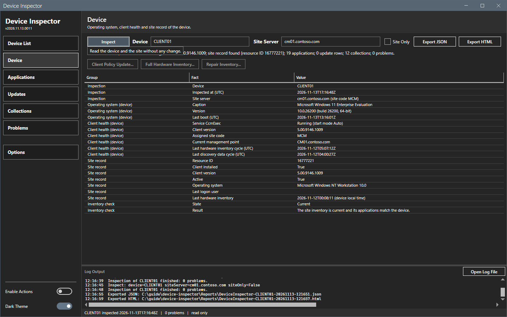

# Keyboard

This page lists the keys that Device Inspector handles.

## What it does

The tool defines one key of its own: Enter in the device box. Every other key is the standard key of a Windows control.

## When to use it

Use this page to work without the mouse.

## Requirements

None.

## Keys

| Key | Context | Effect |
|---|---|---|
| Enter | The device box | Starts **Inspect**. |
| Tab, Shift+Tab | The window | Moves the focus forward or back. |
| Space or Enter | A button | Selects the button. |
| Up, Down | A list or a grid | Moves the selection. |
| Esc | **Options**, a file dialog | Cancels the dialog. |
| Alt+F4 | The window | Closes the window and saves the window state. |

### Tab order

1. The sidebar: **Device list**, **Device**, **Applications**, **Updates**, **Collections**, **Problems**, **Options**.
2. The Inspect bar: **Inspect**, the device box, the site server box, **Site only**, **Export JSON**, **Export HTML**. A button that is off is skipped.
3. The open panel: on the Device panel, the action buttons, then the grid.
4. **Open log file**, then the log.

The focus shows as a thin white frame on a button. A tooltip shows for the button that has the focus.

## Limits

- The Applications filter box and the status list follow the Tab order of the panel.

## Troubleshooting

| Message | Cause | Fix |
|---|---|---|
| A key does nothing. | The step is running, or the button is off. | Wait for the overlay to end. Run **Inspect** to turn on the export buttons. |

## Links

None.
